Start with the run summary, inspect the basin and climate plots, then read the indicators relevant to
your question. This guide helps you locate results, check their status and connect them to climate conditions.

Figures illustrate output formats. In the website chapter, select an image to inspect the full-size
version. The complete HTML manual embeds the images directly; use browser zoom to enlarge them.

All paths below are relative to the output directory set by `project.project_dir` in your case's
project file. For the external case example, this is `C:/cst-cases/runs/my-basin/`.

## The layout

```text
<project_dir>/
├── data/
│   ├── spatial/                         basin geometry and reporting locations
│   └── climate/
│       ├── historical/                  extracted climate and diagnostics
│       └── projections/
│           └── <ensemble>/              projection products
├── models/
│   └── hydrology/
│       └── wflow/                       model, forcing, current historical run and evaluation
├── simulations/
│   └── historical/<name>/               retained historical runs (optional `historical_run`)
├── comparisons/
│   └── historical/<name>/               comparison of retained runs for named forcings
├── scenarios/                           exported climate series and lookup tables
├── experiments/
│   └── <name>/
│       ├── hydrology/
│       │   └── wflow/
│       │       └── output/              saved simulation results
│       └── results/
│           └── indicator_sets/
│               └── <set-id>/            indicator tables and definitions
├── logs/
│   └── <timestamp>__<scope>/             summary, transcript and diagnostics
└── config/                              copies of settings used for each attempt
```

Historical simulations appear in three places. `models/hydrology/wflow/run_default/` holds the current
run and is replaced when the model workflow reruns. `simulations/historical/<name>/` holds named runs kept
unchanged for later comparison, and `comparisons/historical/` compares them. Stress-test simulations
belong to their experiment. See [retained historical simulations](../technical-manual/workflow-build-model.md#retain-historical-simulations).

Keep the complete output directory when archiving an assessment. Indicator CSVs alone do not preserve
the model, climate conditions or calculation settings needed to understand a result. Edit the source
case files when changing settings; the configuration copies in the output directory document past runs.

## Native model grids {#native-grids}

Opt into [native grid output](../technical-manual/configuration.md#netcdf-grid) separately in
the model-building and simulation workflow files. Historical grids are saved at
`models/hydrology/wflow/run_default/output_grid.nc`; selected scenario runs each produce
`experiments/<name>/hydrology/wflow/output/<run_id>.nc`. Open them with xarray or GIS software.
One file holds all requested variables, including native soil layers where present.

Grid storage scales with rectangular cells × timesteps × variable layers × runs. The launcher
reports a conservative raw float64 estimate with no assumed compression saving and reserves space
for retained grids and recovery copies. Compression is lossless but its benefit depends on the data.

Changing historical grid variables requires rerunning the historical simulation; CSVs cannot
reconstruct maps. Historical reruns replace their configured products, so archive completed cases
that must be kept. Disabling output removes the declaration and preserves old files; an old file
is not evidence that the current request produced a grid. Completed ensemble experiments freeze
the request: use `--new-experiment` for a different request. Retain the complete experiment,
including its inventory, when archiving grids.

Before publication or retry reuse, grids must contain finite values on each variable's native support.
Masked cells outside that support remain valid. Units, coordinates, CRS and layers are checked against
expectations captured directly from the initialized Wflow model in `<run>.toml.grid.toml`, beside its
run settings. The retained inventory embeds these expectations, so archived reads do not need Julia
or the original model-input paths. Existing inventories retain their original checksum and reader semantics.

## Check whether a run finished

1. **Read the summary:** open the `summary.md` named by the runner and check outcomes and warnings.
2. **Investigate problems:** follow the workflow-log links. A command may only preview tasks or find
   that existing results need no updates. Successful completion alone does not mean new results were calculated.
3. **Find the products:** confirm that the expected climate series, model responses or indicators exist for
   the selected experiment. If completion is uncertain, check its saved run information using the
   [output reference](../technical-manual/retained-handoffs.md).
4. **Check interpretation:** read indicator definitions, units and limitations before comparing values.
   A completed computation does not establish that its results are suitable for your assessment.

Missing measurements remain unavailable, not zero. Use [benchmarking](../technical-manual/runtime-and-resources.md) for timings.

## Inspect the basin and historical conditions

### Basin maps

Begin with the spatial maps: check the catchment boundary, river network and reporting locations.
<figure class="guide-map-figure">
<div class="guide-map-grid">
<div>
<span class="guide-panel-label">a) Basin and river network</span>

[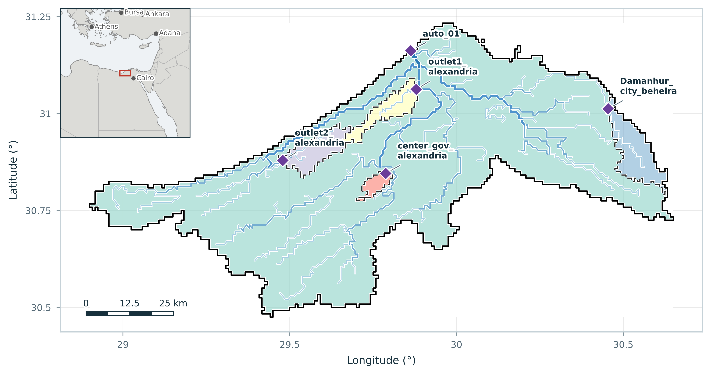{fig-alt="Example basin boundary, river network and reporting locations." width=100%}](assets/illustrations/basin.png)

</div>
<div>
<span class="guide-panel-label">b) Elevation</span>

[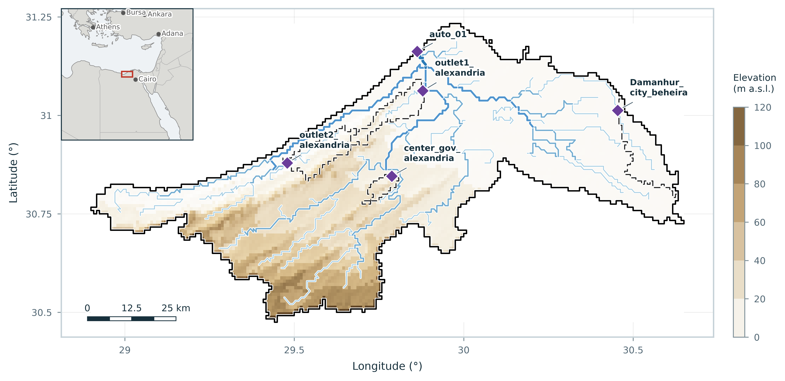{fig-alt="Example elevation map in metres above sea level." width=100%}](assets/illustrations/elevation-map.png)

</div>
<div>
<span class="guide-panel-label">c) Land cover</span>

[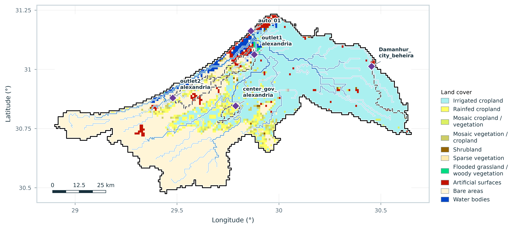{fig-alt="Example map of land-cover classes." width=100%}](assets/illustrations/land-cover-map.png)

</div>
<div>
<span class="guide-panel-label">d) Soil clay content</span>

[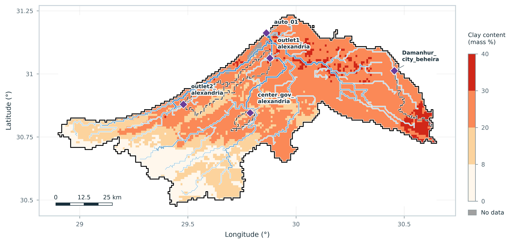{fig-alt="Example soil clay content map in mass percent." width=100%}](assets/illustrations/soil-clay-map.png)

</div>
</div>
<figcaption>Example spatial outputs for inspecting the basin and datasets prepared for your case.</figcaption>
</figure>

### Historical climate

Examine the historical climate diagnostics for coverage, seasonality, variability and differences
between sources. Check each source's available period before choosing historical forcing.

[]{#climate-extent-and-basin-cells}

The extracted climate rectangle includes a one-source-cell margin for forcing preparation; it does
not enlarge the modelled basin. See
[climate grids and basin cells](../technical-manual/data-formats-and-conventions.md#files-prepared-or-read-during-processing)
when comparing the map extents.

<figure class="guide-map-figure">
<div class="guide-map-grid">
<div>
<span class="guide-panel-label">a) Mean annual precipitation</span>

[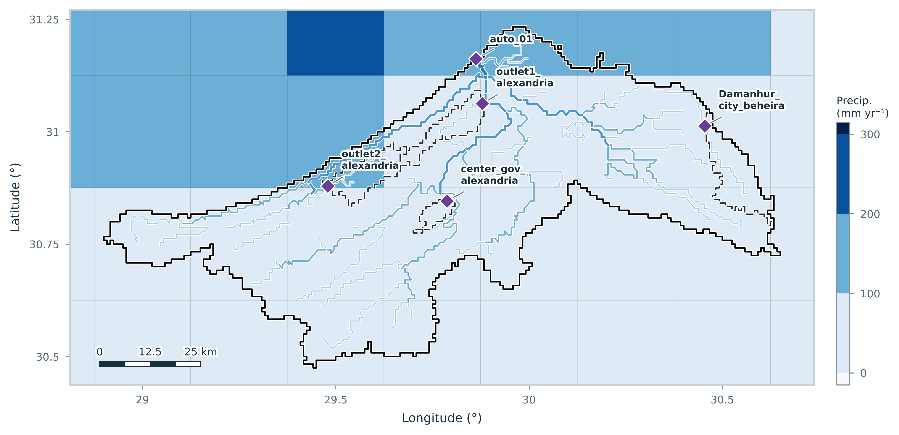{fig-alt="Example ERA5 mean annual precipitation map in millimetres per year." width=100%}](assets/illustrations/precip-map.png)

</div>
<div>
<span class="guide-panel-label">b) Mean annual temperature</span>

[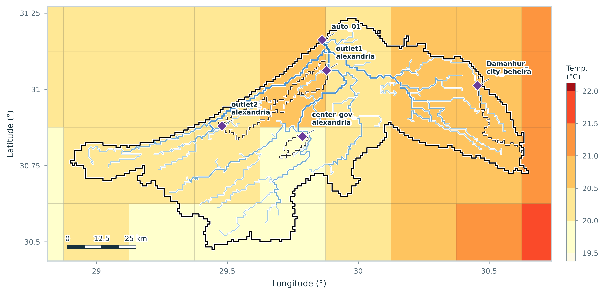{fig-alt="Example ERA5 mean annual temperature map in degrees Celsius." width=100%}](assets/illustrations/temp-map.png)

</div>
</div>
<figcaption>Example historical climate maps, retaining the native climate grid to show its
resolution relative to the basin.</figcaption>
</figure>

<div class="guide-map-grid guide-climate-comparison">
<figure>
<span class="guide-panel-label">a) Seasonal precipitation</span>

[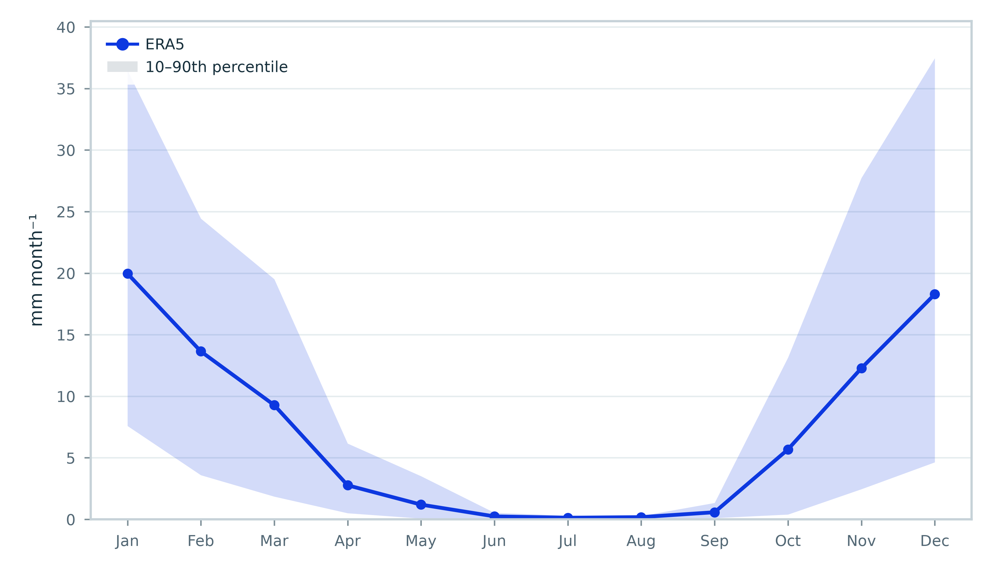{fig-alt="ERA5 mean monthly precipitation with a 10th–90th percentile band." width=100%}](assets/illustrations/climate.png)

<figcaption>ERA5 mean monthly precipitation, with the 10th–90th percentiles across available years.</figcaption>
</figure>

<figure>
<span class="guide-panel-label">b) Annual precipitation</span>

[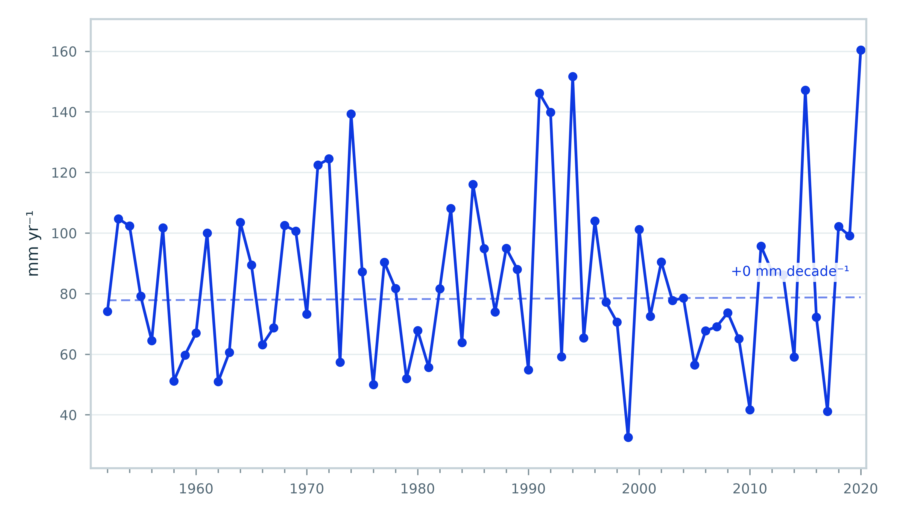{fig-alt="ERA5 annual precipitation totals and Theil–Sen trend." width=100%}](assets/illustrations/annual-precip-trend.png)

<figcaption>ERA5 annual precipitation totals and Theil–Sen trend.</figcaption>
</figure>
</div>

### Historical model

For the historical model, review forcing and evaluation figures under `models/hydrology/wflow/`.
Compare simulated flows with observations when available, and examine the seasonal water balance
and spatial patterns. Source agreement and plausible-looking figures do not replace model evaluation.

<figure class="guide-illustration" style="max-width:480px">

[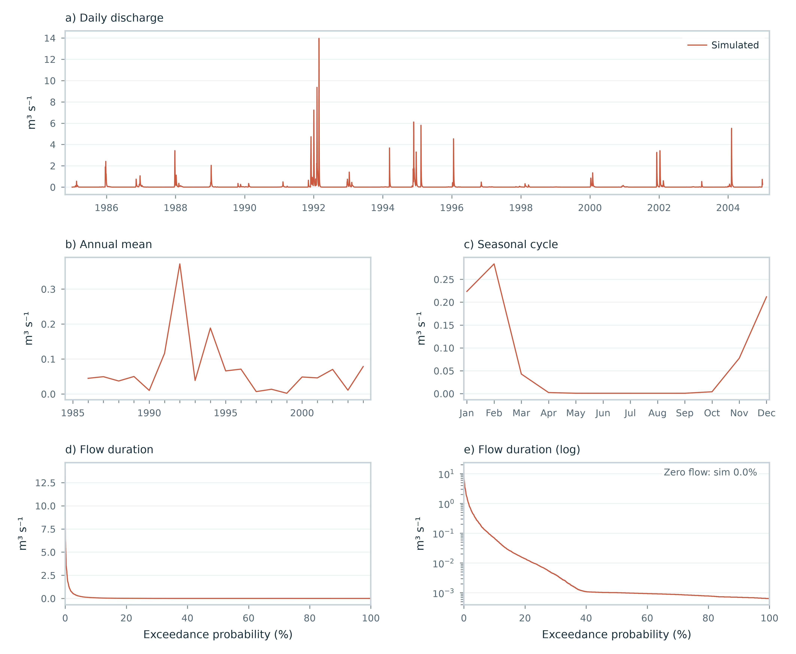{fig-alt="Example discharge diagnostic sheet with daily flows, annual means, seasonal cycle and flow-duration curves." width=100%}](assets/illustrations/hydrograph.png)

<figcaption>Example simulated discharge diagnostics: daily flows, annual means, seasonal cycle and
flow-duration curves.</figcaption>
</figure>

This illustration contains simulated flows only. Comparison with observations requires records supplied
for your own case.

## Reading scenario exports

After scenario generation finishes, `scenarios/` contains weather series and tables describing their
realizations and climate perturbations.

Each experiment uses a specific set of generated climate scenarios. Generating new scenarios can replace
the tables in `scenarios/`, so they may no longer describe an earlier experiment. Check which scenarios
the experiment used before linking its indicators to these tables.

## Reading projection diagnostics

Look in `data/climate/projections/<ensemble>/summary/` for change-factor tables and their data sources.
The `analysis/` tables identify coverage and availability; check whether models, periods or variables
were excluded before comparing the ensemble. Figure captions explain the period and spatial coverage
behind each product. Use projected changes to interpret the climate conditions in your stress test.
Ensemble spread does not assign probabilities to its hydrological outcomes.

When calculated PET is selected, the same tables include `pet`, and the plots add annual anomalies
(mm/year), monthly climatology (mm/day), and annual/seasonal changes (% by default, mm for absolute
changes). Captions name Makkink or de Bruin and the approximation from monthly mean inputs.
Spatial averages use the selected buffered bounding box, including cells outside the basin polygon;
the established `basin_avg` filenames do not imply polygon weighting. PET requires complete joint
meteorological support throughout this box. Near-zero reference rates flag unavailable percentages
while absolute differences remain inspectable. Source paths, units, calendar, method/library and
spatial support are retained in scalar attributes and `_engine/analysis_record.json`.
Optional calculated dew point (`tdew`) and 10 m wind (`wind`) add rows to the same tables and
three figure families: annual anomalies, monthly climatologies and annual/seasonal mean differences.
These are duration-weighted states in degC and m/s. Captions and the analysis inventory distinguish
supplied monthly mean wind speed from magnitude of the monthly mean vector; they preserve method,
height and monthly/buffered-bbox approximations. No derived native-grid files are retained.
See [dew point and wind](../technical-manual/workflow-analyze-projections.md#optional-projected-dew-point-and-wind)
for opt-ins and input qualification limits.

See [projected PET](../technical-manual/workflow-analyze-projections.md#optional-projected-pet)
for configuration, source requirements and qualification limits. PET does not add a stress-test axis.

<figure class="guide-illustration" style="max-width:440px">

[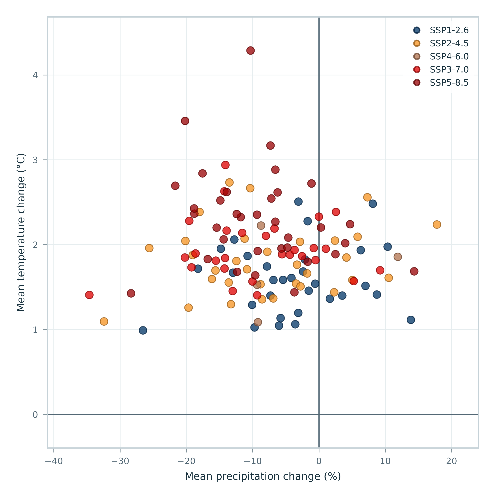{fig-alt="Example paired CMIP6 precipitation and temperature changes, coloured by emissions scenario." width=100%}](assets/illustrations/cmip6-cloud.png)

<figcaption>Example paired precipitation (%) and temperature (°C) changes for 2040–2060 relative
to 1985–2004, with one point per model and scenario after member averaging.</figcaption>
</figure>

Point density does not represent probability.

<figure class="guide-illustration" style="max-width:520px">

[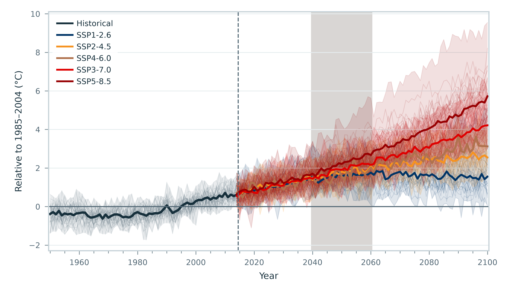{fig-alt="Example annual CMIP6 temperature trajectories with scenario medians and ensemble ranges." width=100%}](assets/illustrations/cmip6-temperature.png)

<figcaption>Example temperature trajectories relative to 1985–2004, with model medians and ranges.
Shading marks the future comparison period.</figcaption>
</figure>

Members are averaged within each model before summarizing across models. The ribbons show the model
range, not a confidence interval.

<figure class="guide-illustration" style="max-width:560px">

[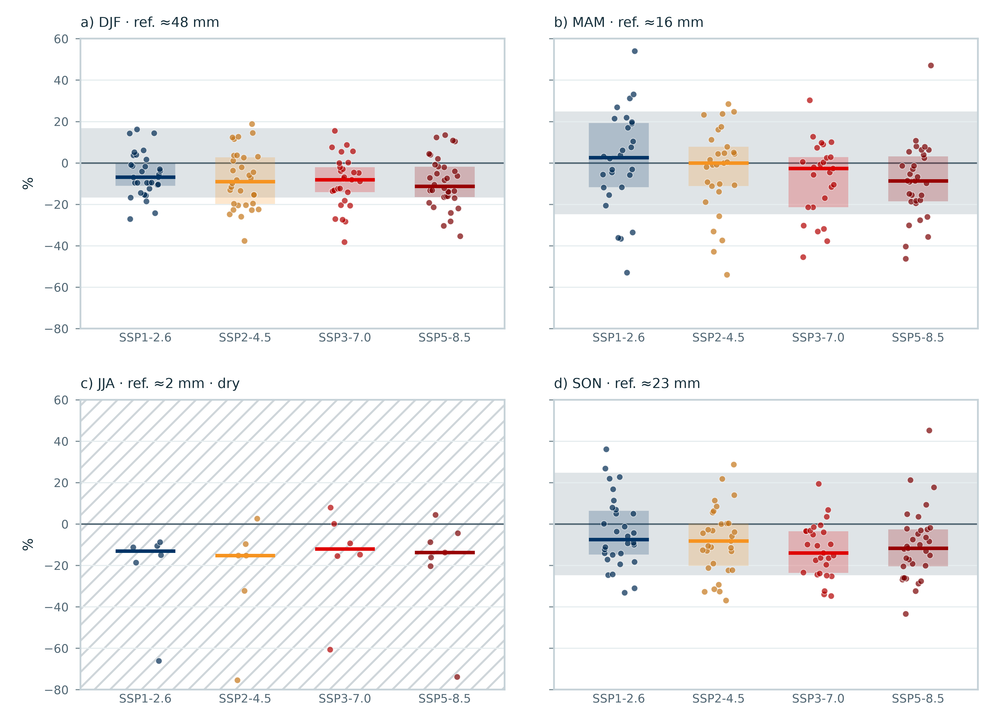{fig-alt="Seasonal precipitation changes in percent for four supported emissions scenarios; hatching identifies the dry summer season." width=100%}](assets/illustrations/cmip6-seasonal-precip.png)

<figcaption>Seasonal precipitation changes (%) for 2040–2060 relative to 1985–2004, showing individual
models, medians and interquartile ranges.</figcaption>
</figure>

Points show models, bars mark medians, and boxes span interquartile ranges where at least ten models
contribute. The grey band estimates variation between period means from historical interannual
variability, assuming independent years. Hatching flags a dry season with too few eligible models for
a representative summary. SSP4-6.0 is omitted here because only four models contribute. DJF, MAM, JJA
and SON denote the four three-month seasons.

<figure class="guide-illustration" style="max-width:560px">

[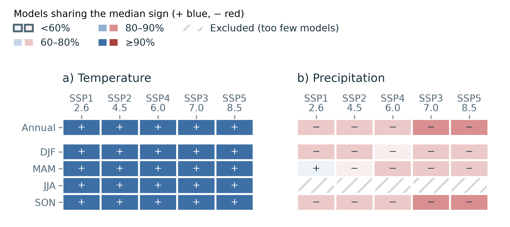{fig-alt="Annual and seasonal model agreement on temperature and precipitation change, with signs and percentage classes; hatching marks excluded results." width=100%}](assets/illustrations/cmip6-agreement.png)

<figcaption>Annual and seasonal agreement: the proportion of eligible models sharing the median
direction of change for 2040–2060 relative to 1985–2004.</figcaption>
</figure>

Read the signs and agreement classes together; consult the accompanying tables for model counts.
Hatching identifies excluded results with too few eligible models. Agreement describes direction,
not magnitude, probability or statistical significance.

[]{#moving-projection-results-to-another-project}

To share these products with another project, follow
[Transfer climate-projection results](running.md#transfer-climate-projection-results).

## Reading an indicator set

For post-processing, open the CSVs in `experiments/<name>/results/indicator_sets/<set-id>/`.
There is one folder per selected indicator set: `default` unless `project_config_simulate_system.yml`
selects others.

For example, a `default` set containing river discharge indicators looks like this:

```text
experiments/stress_test_01/results/indicator_sets/default/
├── indicators.csv          # Indicator definitions, units and coverage
├── group_members.csv       # Runs included in each group
├── group_metadata.csv      # Climate perturbation and reference status of each group
├── q_run_indicators.csv    # Indicator values for each run and location
└── q_group_indicators.csv  # Indicator values for each group and location
```

Here, `q` means river discharge. Other selected variables have their own run and group tables.

**Start with `indicators.csv`.** Read the definition, units, reporting period and coverage for your
chosen indicator: what does the value measure, over which period, and from how much usable data?
The manual explains [what each table contains](../technical-manual/results-and-interpretation.md#indicator-table-structure).

For annual totals such as precipitation or evapotranspiration, check `block_coverage` for missing days
and incomplete years. With the default set, totals in mm represent mean annual depth in mm/yr only
when all contributing years are complete and contain no missing values.
See the [default conventions](../../blueearth_cst/indicators/sets/default/README.md).

**Check `status` and `reason` before reading a value:**

- `available`: a value was calculated.
- `undefined`: the calculation is undefined under the set's conventions.
- `unavailable`: no value could be calculated; in partial mode this can reflect missing parameters
  at locations included in the saved simulations.

If a required response variable is absent, the calculation is omitted from the value tables.
Check its declaration and explanation in the dictionary
and `indicators.json` manifest instead.
Read these alongside the dictionary and selected [set conventions](new-case.md#choose-indicators).
Do not compare a missing value as if it were zero.
For return levels, consult the Technical manual's
[estimation methods and limits](../technical-manual/indicator-calculations.md#return-level-estimation-and-supporting-evidence).
For advanced details, see [input evaluation and recovery](../technical-manual/indicator-requests.md#inputs-evaluation-and-recovery).

## Join an indicator to its climate settings

To interpret an indicator, identify the climate conditions it represents. Results for individual
simulations and groups of simulations connect to climate settings in different ways, as shown below.

Use the scenario tables associated with your experiment. The same run or group label in another
experiment may refer to different simulations.

The examples below read tables only. Replace `run_root`, `experiment` and `set_id` for your results.

```python
from pathlib import Path
import pandas as pd

run_root = Path("C:/path/to/case-output")
experiment = "stress_test_01"
set_id = "default"
collection = run_root / "scenarios/stochastic-2040-2060"  # name listed in scenarios/collections.csv
results = run_root / "experiments" / experiment / "results/indicator_sets" / set_id
scenarios = pd.read_csv(
    collection / "scenario_run_lookup.csv", dtype=str, keep_default_na=False
)
perturbations = pd.read_csv(
    collection / "perturbation_lookup.csv", dtype={"st_id": str}, keep_default_na=False
)
```

First check that the scenario tables describe the climate scenarios used by your experiment.
If newer scenarios have replaced them, use the preserved tables at the paths recorded for that experiment.

1. Connect each simulation's indicators to its climate scenario using `run_id`:

   ```python
   runs = pd.read_csv(results / "q_run_indicators.csv", dtype={"run_id": str, "location": str})
   run_settings = runs.merge(scenarios, on="run_id", how="left", validate="many_to_one")
   ```

2. Connect each group's indicators to its climate settings using `group_id`:

   ```python
   groups = pd.read_csv(results / "q_group_indicators.csv", dtype={"group_id": str, "location": str})
   coordinates = pd.read_csv(results / "group_metadata.csv", dtype=str, keep_default_na=False)
   group_settings = groups.merge(coordinates, on="group_id", how="left", validate="many_to_one")
   ```

For either table, `st_id` then joins to `perturbation_lookup.csv` for monthly changes.
That lookup has twelve rows per perturbed point, so this further join expands rows; it is not
a one-row-per-indicator table. The unperturbed reference has empty `st_id` and `is_reference=true`
in group metadata. Keep it explicitly: an inner perturbation join would drop it.
Use `group_members.csv` to inspect contributing runs, including singleton groups.
These joins identify which climate conditions belong to each value. They do not construct a response
surface; that requires a separate analysis of the selected indicators and their scenario coverage.

### Opening an indicator table in Excel

Run IDs such as `run_01` and group IDs such as `group_01` are prefixed strings, so opening the CSV
normally keeps them as text.
When importing perturbation `st_id` values, explicitly preserve them as text in Excel and code.

When reading lookup tables in pandas, use `dtype=str` to preserve identifiers and
`keep_default_na=False` to retain the empty reference `st_id`.
Indicator `value` columns remain numeric.

Keep these identifier conventions in mind when joining tables:

- Each kind of ID uses a consistent number of digits within the relevant scenario collection or indicator set.
- Groups are numbered independently of run count and selected indicators.
- The same label in different scenario collections or indicator sets may refer to different simulations.

## Are these outputs current?

```{=html}
<span id="which-run-produced-these-files"></span>
```

A partial rerun can leave files produced at different times. Check the run summary and saved information
for each output; the newest log folder alone is not enough. The manual explains
[how to identify the source run](../technical-manual/results-and-interpretation.md#checking-which-results-are-current).

Check the saved information about the simulations and indicator calculations, along with the run summary.
Changing scientific simulation inputs requires a new experiment. Changing indicator choices can produce
new tables from completed simulations, provided the required model variables were saved.
See [recalculation](running.md#calculate-different-indicators-from-existing-simulations).
Read the result tables after the command finishes. Each indicator set is updated separately; if one fails,
its previous results may remain in place. Check the summary to see which sets were updated successfully.
Keep your own analysis files separate from generated outputs, which the toolbox may replace on rerun.
