Start with the [run summary](glossary.md#run-summary), inspect the basin and climate plots, then read the
indicators relevant to your question. This guide helps you locate results, check their status and connect them
to climate conditions.

Figures illustrate output formats. They come from an arid test basin, not from the quick-start catchment in
Gabon, so your values and maps will differ. In the website chapter, select an image to inspect the full-size
version. The complete HTML manual embeds the images directly; use browser zoom to enlarge them.

All paths below are relative to the [output directory](glossary.md#output-directory) set by
`project.project_dir` in your [case](glossary.md#case)'s [project file](glossary.md#project-file). For the
external case example, this is `C:/cst-cases/my-basin/default/outputs/`.

## The layout

```text
<project_dir>/
├── data/
│   ├── spatial/                         basin geometry and reporting locations
│   └── climate/
│       ├── historical/                  extracted climate per dataset and their diagnostics
│       │   └── source_comparison/       comparison of the climate datasets
│       └── projections/
│           └── <ensemble>/              projection products
├── models/
│   └── hydrology/
│       └── wflow/                       one model: static maps, TOMLs, _engine/
│           └── historical/
│               ├── <recipe>/            forcing, run, plots and tables per forcing recipe
│               └── forcing_comparison/  comparison of two or more recipes
├── scenarios/
│   └── <name>/                          one scenario set: series, lookups, settings
├── experiments/
│   └── <name>/
│       ├── simulations/<run_id>/       saved simulation results, one folder per run
│       └── results/
│           └── indicator_sets/
│               └── <set-id>/            indicator tables and definitions
├── logs/
│   └── <timestamp>__<scope>/             summary, transcript and diagnostics
└── config/                              the settings each workflow ran with
```

Folders named `_engine/` hold the toolbox's own records; you do not need to open them. Everything you read
(tables, figures, settings copies, reports) sits outside them.

Each [forcing recipe](glossary.md#forcing-recipe)'s historical simulation is in
`models/hydrology/<model>/historical/<recipe>/` (`default` for a single recipe); with two or more recipes,
`historical/forcing_comparison/` compares them. The default model is `wflow`. A further model, such as a
registered calibration, has its own folder beside it, and `models/hydrology/comparisons/<name>/` compares
models. See [one model per folder](../technical-manual/workflow-build-model.md#model-versions).

To archive an assessment, keep the whole output directory: indicator tables alone do not record the model,
climate conditions or settings behind them. Change settings in the case files; the copies under `config/`
record past runs.

## Native model grids {#native-grids}

Opt into [native grid output](../technical-manual/configuration.md#netcdf-grid) separately in the
model-building and simulation [workflow files](glossary.md#workflow-file). Historical grids are saved at
`models/hydrology/wflow/historical/default/run/output_grid.nc`; selected scenario runs each produce
`experiments/<name>/simulations/<run_id>/output_grid.nc`.

## Check whether a run finished

1. **Read the summary:** open the `summary.md` named by the run command and check outcomes and warnings.
2. **Investigate problems:** follow the workflow-log links. A command may only preview tasks or find
   that existing results need no updates. Successful completion alone does not mean new results were calculated.
3. **Find the results:** confirm that the expected climate series, model responses or indicators exist for the
   selected experiment. If completion is uncertain, check its saved run information using the
   [output reference](../technical-manual/retained-handoffs.md).
4. **Check interpretation:** read indicator definitions, units and limitations before comparing values.
   A completed computation does not establish that its results are suitable for your assessment.

Missing measurements remain unavailable, not zero. Use [benchmarking](../technical-manual/runtime-and-resources.md) for timings.

## Inspect the basin and historical conditions

### Basin maps

Begin with the spatial maps: check the catchment boundary, river network and
[reporting locations](glossary.md#reporting-location).
<figure class="guide-map-figure">
<div class="guide-map-grid">
<div>
<span class="guide-panel-label">a) Basin and river network</span>

[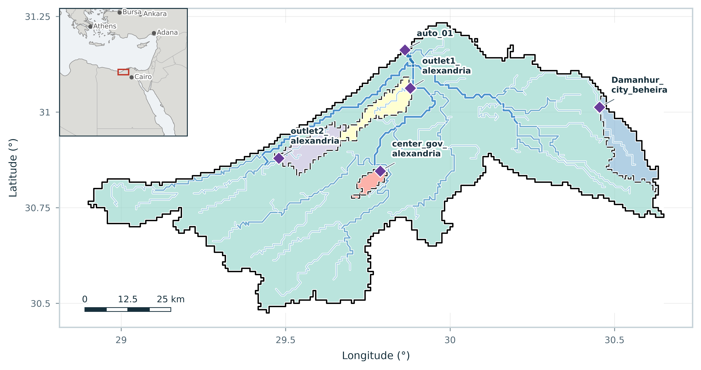{fig-alt="Example basin boundary, river network and reporting locations." width=100%}](assets/illustrations/basin.png)

</div>
<div>
<span class="guide-panel-label">b) Elevation</span>

[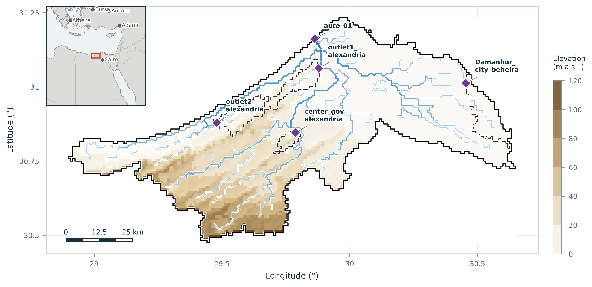{fig-alt="Example elevation map in metres above sea level." width=100%}](assets/illustrations/elevation-map.png)

</div>
<div>
<span class="guide-panel-label">c) Land cover</span>

[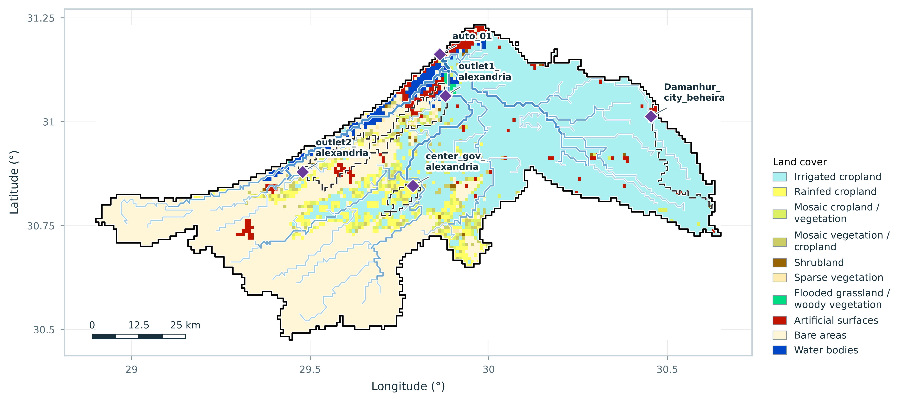{fig-alt="Example map of land-cover classes." width=100%}](assets/illustrations/land-cover-map.png)

</div>
<div>
<span class="guide-panel-label">d) Soil clay content</span>

[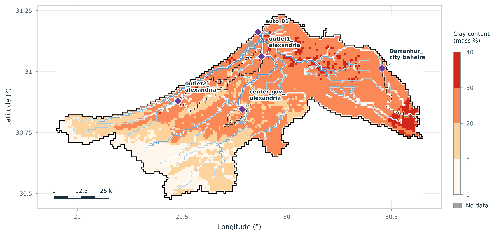{fig-alt="Example soil clay content map in mass percent." width=100%}](assets/illustrations/soil-clay-map.png)

</div>
</div>
<figcaption>Example spatial outputs for inspecting the basin and datasets prepared for your case.</figcaption>
</figure>

### Historical climate

Examine the historical climate diagnostics for coverage, seasonality, variability and differences
between sources. Check each source's available period before choosing historical forcing.

[]{#climate-extent-and-basin-cells}

The extracted climate rectangle includes a one-source-cell margin for forcing preparation; it does
not enlarge the modelled basin. See
[climate grids and basin cells](../technical-manual/data-formats-and-conventions.md#files-prepared-or-read-during-processing)
when comparing the map extents.

<figure class="guide-map-figure">
<div class="guide-map-grid">
<div>
<span class="guide-panel-label">a) Mean annual precipitation</span>

[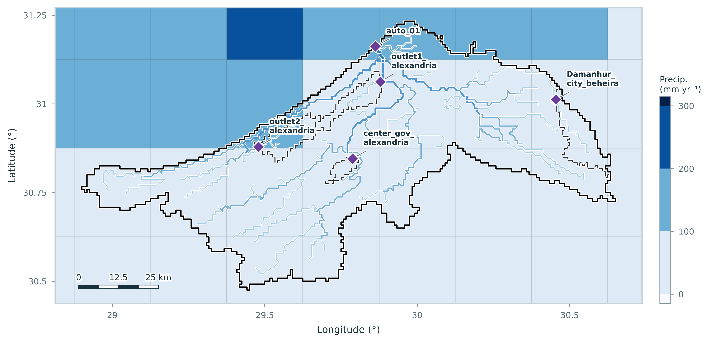{fig-alt="Example ERA5 mean annual precipitation map in millimetres per year." width=100%}](assets/illustrations/precip-map.png)

</div>
<div>
<span class="guide-panel-label">b) Mean annual temperature</span>

[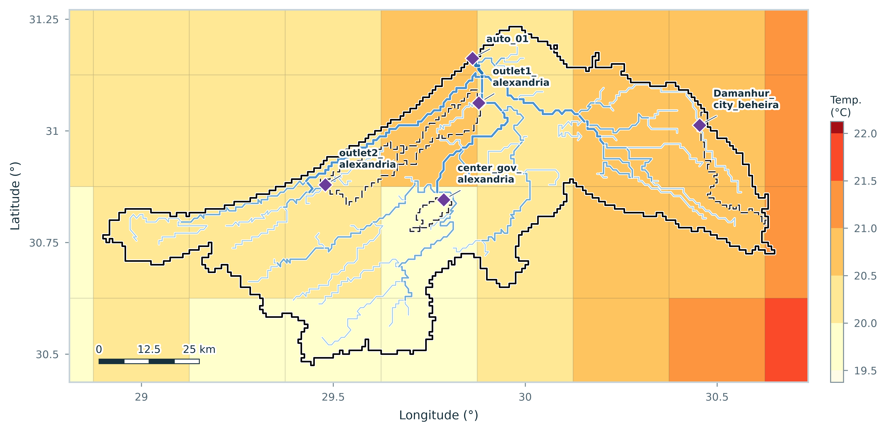{fig-alt="Example ERA5 mean annual temperature map in degrees Celsius." width=100%}](assets/illustrations/temp-map.png)

</div>
</div>
<figcaption>Example historical climate maps, keeping the native climate grid to show its
resolution relative to the basin.</figcaption>
</figure>

<div class="guide-map-grid guide-climate-comparison">
<figure>
<span class="guide-panel-label">a) Seasonal precipitation</span>

[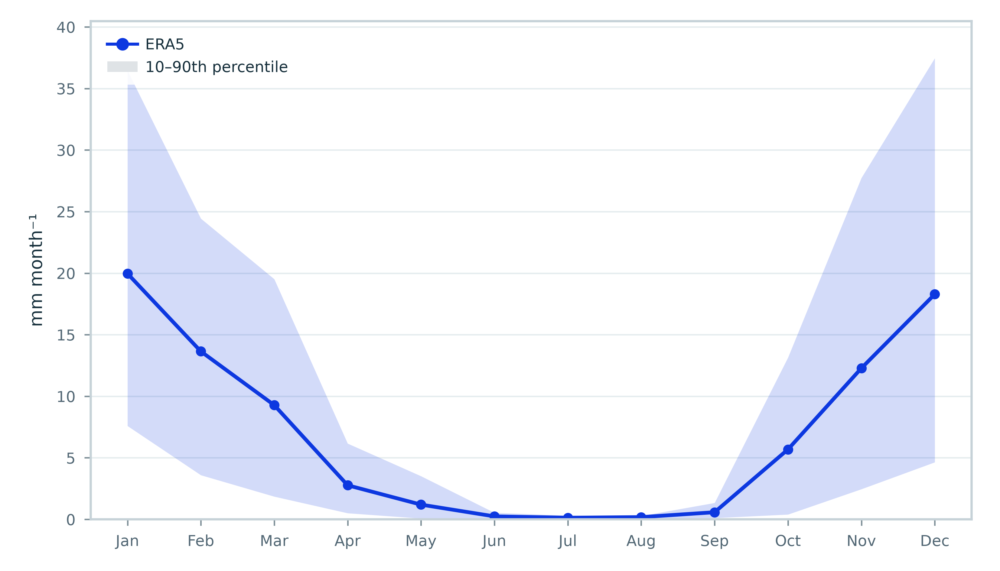{fig-alt="ERA5 mean monthly precipitation with a 10th–90th percentile band." width=100%}](assets/illustrations/climate.png)

<figcaption>ERA5 mean monthly precipitation, with the 10th–90th percentiles across available years.</figcaption>
</figure>

<figure>
<span class="guide-panel-label">b) Annual precipitation</span>

[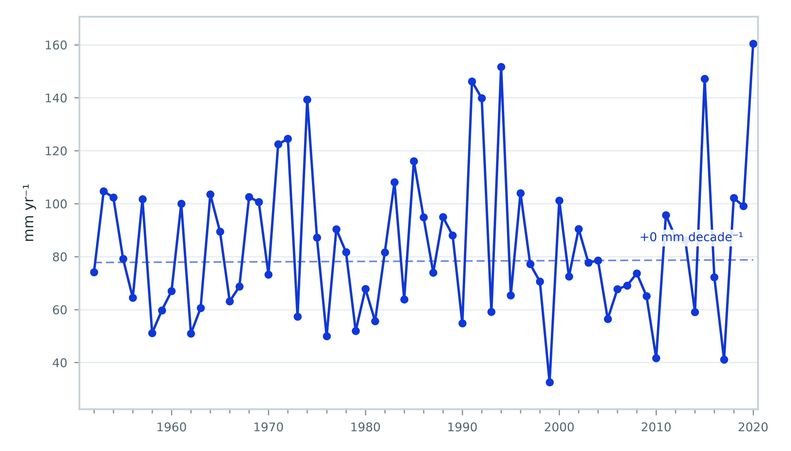{fig-alt="ERA5 annual precipitation totals and Theil–Sen trend." width=100%}](assets/illustrations/annual-precip-trend.png)

<figcaption>ERA5 annual precipitation totals and Theil–Sen trend.</figcaption>
</figure>
</div>

### Historical model

For the historical model, review forcing and evaluation figures under `models/hydrology/wflow/`.
Compare simulated flows with observations when available, and examine the seasonal water balance
and spatial patterns. Source agreement and plausible-looking figures do not replace model evaluation.

<figure class="guide-illustration" style="max-width:480px">

[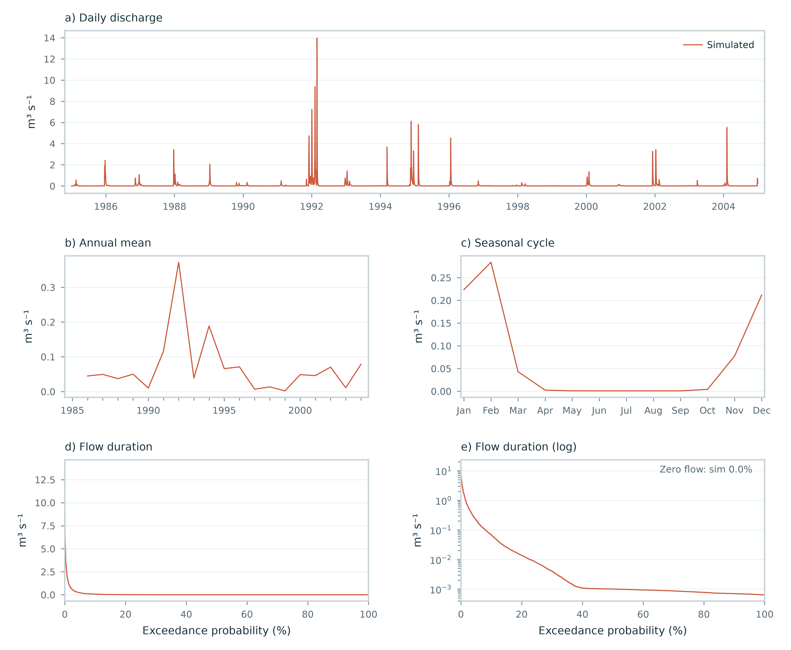{fig-alt="Example discharge diagnostic sheet with daily flows, annual means, seasonal cycle and flow-duration curves." width=100%}](assets/illustrations/hydrograph.png)

<figcaption>Example simulated discharge diagnostics: daily flows, annual means, seasonal cycle and
flow-duration curves.</figcaption>
</figure>

This illustration contains simulated flows only. Comparison with observations requires records supplied
for your own case.

## Reading scenario exports

After scenario generation finishes, `scenarios/` contains weather series and tables describing their
[realizations](glossary.md#realization) and climate perturbations.

Each experiment uses a specific set of generated climate scenarios. Generating new scenarios can replace
the tables in `scenarios/`, so they may no longer describe an earlier experiment. Check which scenarios
the experiment used before linking its indicators to these tables.

## Reading projection diagnostics

Look in `data/climate/projections/<ensemble>/summary/` for change-factor tables and their data sources. The
`analysis/` tables identify coverage and availability; check whether models, periods or variables were
excluded before comparing the ensemble. Figure captions explain the period and spatial coverage behind each
figure. Use projected changes to interpret the climate conditions in your stress test. Ensemble spread does
not assign probabilities to its hydrological outcomes.

Figures cover precipitation and temperature only; calculated PET, dew point and wind add rows to the same
tables. See [dew point and wind](../technical-manual/workflow-analyze-projections.md#optional-projected-dew-point-and-wind)
for their methods, spatial averaging and records.

See [projected PET](../technical-manual/workflow-analyze-projections.md#optional-projected-pet)
for configuration, source requirements and qualification limits. PET does not add a stress-test axis.

<figure class="guide-illustration" style="max-width:440px">

[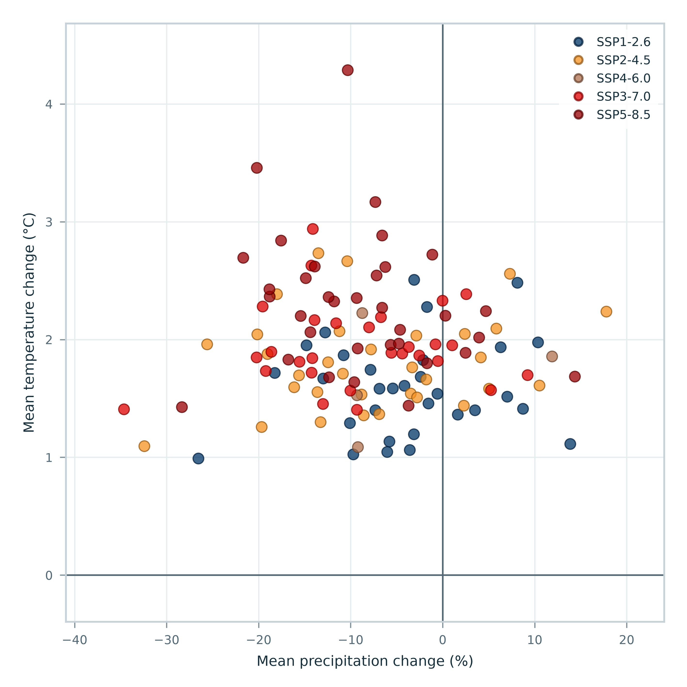{fig-alt="Example paired CMIP6 precipitation and temperature changes, coloured by emissions scenario." width=100%}](assets/illustrations/cmip6-cloud.png)

<figcaption>Example paired precipitation (%) and temperature (°C) changes for 2040–2060 relative
to 1985–2004, with one point per model and scenario after member averaging.</figcaption>
</figure>

Point density does not represent probability.

<figure class="guide-illustration" style="max-width:520px">

[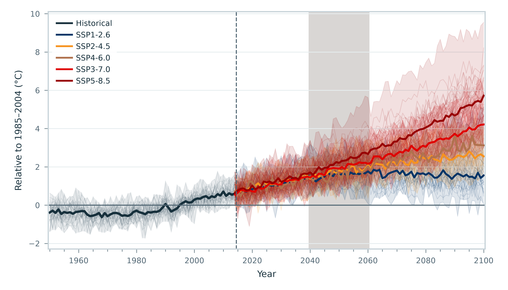{fig-alt="Example annual CMIP6 temperature trajectories with scenario medians and ensemble ranges." width=100%}](assets/illustrations/cmip6-temperature.png)

<figcaption>Example temperature trajectories relative to 1985–2004, with model medians and ranges.
Shading marks the future comparison period.</figcaption>
</figure>

Members are averaged within each model before summarizing across models. The ribbons show the model
range, not a confidence interval.

<figure class="guide-illustration" style="max-width:560px">

[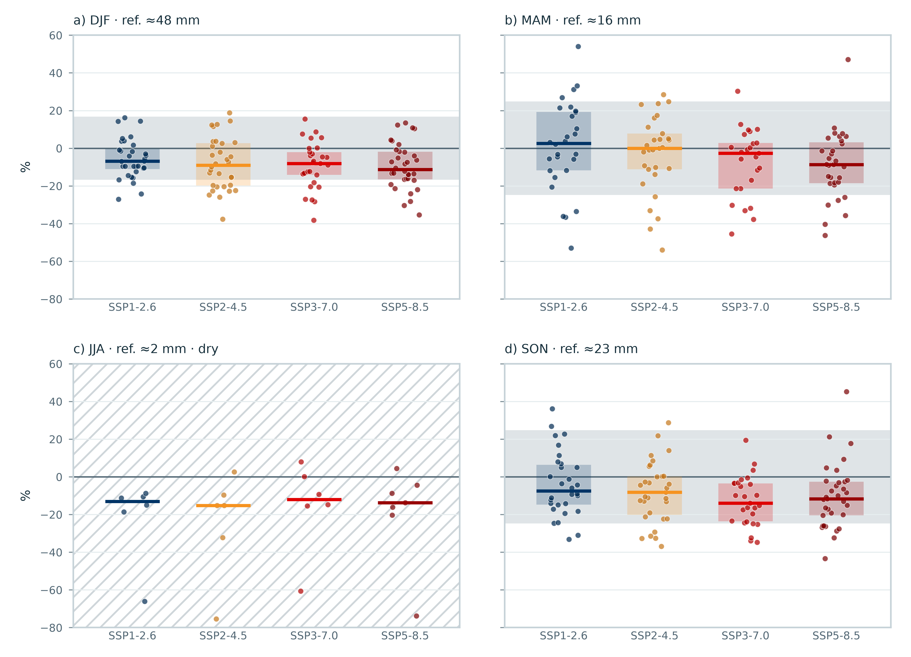{fig-alt="Seasonal precipitation changes in percent for four supported emissions scenarios; hatching identifies the dry summer season." width=100%}](assets/illustrations/cmip6-seasonal-precip.png)

<figcaption>Seasonal precipitation changes (%) for 2040–2060 relative to 1985–2004, showing individual
models, medians and interquartile ranges.</figcaption>
</figure>

Points show models, bars mark medians, and boxes span interquartile ranges where at least ten models
contribute. The grey band estimates variation between period means from historical interannual
variability, assuming independent years. Hatching flags a dry season with too few eligible models for
a representative summary. SSP4-6.0 is omitted here because only four models contribute. DJF, MAM, JJA
and SON denote the four three-month seasons.

<figure class="guide-illustration" style="max-width:560px">

[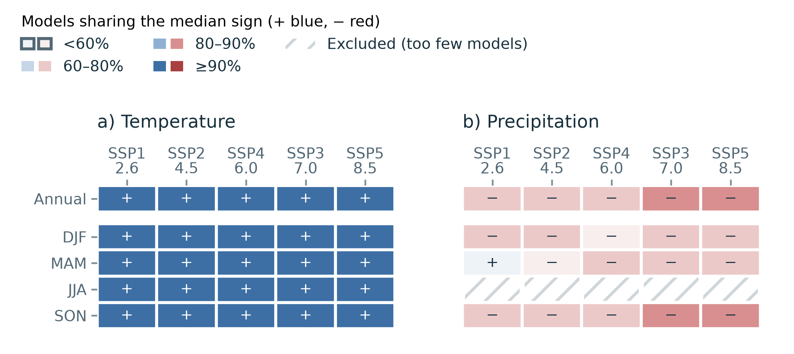{fig-alt="Annual and seasonal model agreement on temperature and precipitation change, with signs and percentage classes; hatching marks excluded results." width=100%}](assets/illustrations/cmip6-agreement.png)

<figcaption>Annual and seasonal agreement: the proportion of eligible models sharing the median
direction of change for 2040–2060 relative to 1985–2004.</figcaption>
</figure>

Read the signs and agreement classes together; consult the accompanying tables for model counts.
Hatching identifies excluded results with too few eligible models. Agreement describes direction,
not magnitude, probability or statistical significance.

[]{#moving-projection-results-to-another-project}

To share these results with another project, follow
[Transfer climate-projection results](advanced-tasks.md#transfer-climate-projection-results).

## Stress-test results {#stress-test-results}

[]{#reading-an-indicator-set}
[]{#join-an-indicator-to-its-climate-settings}
[]{#opening-an-indicator-table-in-excel}

Indicator tables are in `experiments/<name>/results/indicator_sets/<set-id>/`.
[Stress-test results](results.md) explains what each table holds, how to check a value's status and how to
link it to its climate perturbation.

## Are these outputs current?

```{=html}
<span id="which-run-produced-these-files"></span>
```

A partial rerun can leave files from different runs side by side, and each indicator set is updated
separately, so a failed set may leave its previous tables in place. Check the run summary and the saved
records for each output to see which sets were updated; the newest log folder alone is not enough. Keep your
own analysis files outside the generated folders, which the toolbox may replace on rerun. The manual explains
[how to identify the source run](../technical-manual/results-and-interpretation.md#checking-which-results-are-current).
