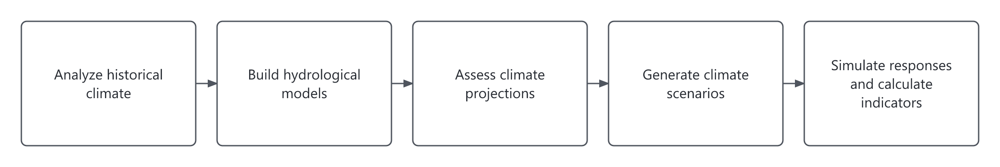

This guide walks you through a catchment-scale climate stress test with the CST Toolbox. You will
analyze historical climate data, build a distributed hydrological model and explore how the catchment
responds to changes in temperature and precipitation. Hydrological indicators summarize these responses,
while climate projections provide context for interpreting the changes tested.

The example uses a small catchment in Gabon, a limited temperature × precipitation grid and two weather
realizations to keep computation manageable. You will run the workflows, check their completion and
explore the results. The short simulation period and small sample are intended for learning the toolbox;
they are insufficient for estimating basin flood or drought return levels.

Complete the [installation guide](install.md), including the installation check and data-access
checks. The example requires datasets on the Deltares P-drive and internet access for CMIP6 data.
Installing the software does not download these input datasets.

Run the commands below in PowerShell from the `blueearth_cst` folder created during installation.
Run time depends on downloads, data access and your computer's capacity. You will also need disk space
for the model, climate series and simulation outputs.

If you do not have access to the supplied data sources, follow
[Creating a project](new-case.md) to configure sources available to you before running workflows.

## 1. Understand what the example runs

The toolbox has five workflows, each producing outputs you can inspect or use in later stages.
The example runs all five; you can also run individual workflows to suit your question.

Historical climate analysis, model building, projection analysis and scenario generation are separate
entry points. You can compare climate sources, examine projections or generate scenarios without
running a hydrological simulation.

All workflows share a basin boundary and, where needed, subbasins, river networks and output locations.
The toolbox prepares these spatial data and reuses them when inputs are unchanged. Scenario generation
does not need the river or subbasin layers. Hydrological simulations require a prepared model and
generated scenarios.

- **Extract and analyze historical climate data.** Extracts climate data for the catchment and
  summarizes spatial patterns, seasonality and variability to help you select historical forcing.

- **Build and verify hydrological models.** Builds a distributed hydrological model from global
  datasets and runs it with historical forcing to examine the setup and hydrological behavior.

- **Assess projected climate changes.** Summarizes relevant climate projections for the catchment
  to help judge the plausibility of the tested climate changes, without determining the stress-test grid.

- **Generate climate scenarios.** Generates weather realizations from historical climate data
  across a temperature × precipitation grid and an unperturbed reference, representing natural variability.

- **Simulate hydrological responses and evaluate indicators.** Runs the prepared hydrological
  model with generated climate series and calculates indicators to compare responses across climate
  perturbations and against the unperturbed reference.



**Toolbox workflows.** Arrows show the example execution order. Workflows can also run independently
when their required inputs are available. Hydrological simulations need a prepared model and generated
scenarios.

## 2. Run the example

The supplied configuration covers an approximately 220 km² catchment east of Libreville, Gabon.
It uses ERA5 data from 2000–2016 to generate two weather realizations across a 2 × 2
temperature–precipitation grid for 2046–2054. Climate perturbations are relative to this historical
period, with a generated, unperturbed reference for comparison. Climate projections use a separate
2000–2014 reference period. Once data access is set up, no configuration edits are needed.

From your `blueearth_cst` folder, run:

```powershell
pixi run python scripts/run_workflows.py --config test_case/project_config_rapid.yml --project-dir test_case/test_rapid --cores 3
```

This uses up to three CPU cores and saves outputs to `test_case/test_rapid/`. To preview the planned
tasks first, append `-- --dry-run` to the command.

**While it runs:**

- Check the opening summary for the expected basin, configuration and output folder.
  On a first run, `not delineated yet` is normal.
- Keep PowerShell open and run only one command against this output folder at a time.
  The toolbox reports progress and stops if a workflow fails.

**When it finishes:** open the `summary.md` linked in the closing console message. Check each workflow's
outcome and any warnings; follow the log links if something needs investigation.

Successful execution confirms that the example ran. Suitability for a real assessment needs further evaluation.

## 3. Explore the results

Outputs are saved under `test_case/test_rapid/`:

```text
test_case/test_rapid/
├── data/           # Spatial data, historical climate and projections
├── models/         # Hydrological model and historical simulation
├── scenarios/      # Generated climate series and lookup tables
├── experiments/    # Simulated responses and indicators
├── logs/           # Run summaries, logs and timings
└── config/         # Archived settings and commands
```

**Start with the plots.** Check the basin boundary, climate coverage and seasonal patterns.
Use [Reading the outputs](outputs.md) to locate the plots and interpret them.

**Then inspect the indicator tables** in:

```text
test_case/test_rapid/experiments/experiment_rapid/results/indicator_sets/default/
```

1. **Definitions:** open `indicators.csv` for indicator descriptions and units.
2. **Individual runs:** open `q_run_indicators.csv`. Check `status` and `reason` before reading `value`;
   an unavailable value is not zero.
3. **Grouped results:** open `q_group_indicators.csv` alongside `group_metadata.csv` to identify each
   group's climate perturbation and reference status.

The output guide explains how to link these tables to their source runs and climate perturbations.
Treat the rapid example's return levels as demonstrations of the calculation, not basin estimates.

For setup errors or interrupted runs, see [Troubleshooting](troubleshooting.md).

## Next

- [Creating a project](new-case.md) — configure an external basin assessment.
- [Running the workflows](running.md) — individual workflow commands and how to resume a case.
- [Reading the outputs](outputs.md) — find and interpret results, and check which inputs produced them.
