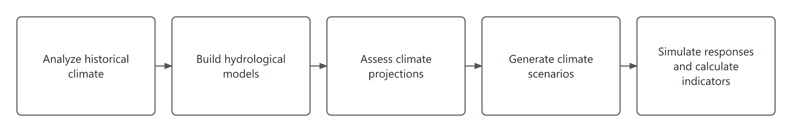

This guide walks you through a catchment-scale climate stress test with the CST Toolbox. You will
analyze historical climate data, build a distributed hydrological model and explore how the catchment
responds to changes in temperature and precipitation. Hydrological indicators summarize these responses,
while climate projections provide context for interpreting the changes tested.

The example uses a small catchment in Gabon, a limited temperature × precipitation grid and two weather
[realizations](glossary.md#realization) to keep computation manageable. You will run the workflows, check
their completion and explore the results. The short simulation period and small sample are intended for
learning the toolbox, not for a basin assessment.

**Data access:** the example reads datasets on the Deltares P-drive and downloads CMIP6 data from the
internet. Installing the software does not download these datasets. Without P-drive access the example
cannot run as supplied; follow [Creating a project](new-case.md) to configure sources available to you.

Complete the [installation guide](install.md), including the installation and data-access checks. Run the
commands below in PowerShell from the `blueearth_cst` folder created during installation. Run time depends
on downloads, data access and your computer's capacity. You will also need disk space for the model,
climate series and simulation outputs.

## Understand what the example runs

The example runs all five [workflows](glossary.md#workflow). The table shows what each one gives you and what
it needs, so that later you can run only the workflows your question requires. The toolbox prepares the shared
basin boundary, subbasins, river network and [reporting locations](glossary.md#reporting-location) once and
reuses them while their inputs are unchanged.

| Workflow | Output | Needs |
|---|---|---|
| Historical climate analysis | Maps, seasonality and variability of the candidate historical climate datasets, to help you choose [historical forcing](glossary.md#historical-forcing) | Basin outline and historical climate data |
| Model building | A distributed hydrological model built from global datasets, run with historical forcing so that you can check its setup and behavior | Basin outline, global spatial datasets and the chosen historical forcing |
| Projection analysis | Projected temperature and precipitation changes for the basin, to judge how plausible the tested changes are; they do not set the stress-test grid | Basin outline and internet access to CMIP6 data |
| Scenario generation | Weather realizations across a temperature × precipitation grid and an [unperturbed reference](glossary.md#unperturbed-reference), representing natural variability | Basin outline and the chosen historical forcing; no model, river or subbasin layers |
| Hydrological simulation and indicators | Simulated responses and indicators to compare climate perturbations with each other and with the unperturbed reference | A built model and generated scenarios |



**Toolbox workflows.** Arrows show the example execution order. Workflows can also run independently
when their required inputs are available. Hydrological simulations need a prepared model and generated
scenarios.

## Run the example

The supplied configuration covers an approximately 220 km² catchment east of Libreville, Gabon.
It uses ERA5 data from 2000–2016 to generate two weather realizations across a 2 × 2
temperature–precipitation grid for 2046–2054. Climate perturbations are relative to this historical
period, with a generated, unperturbed reference for comparison. Climate projections use a separate
2000–2014 reference period. Once data access is set up, no configuration edits are needed.

From your `blueearth_cst` folder, run:

```powershell
pixi run python scripts/run_workflows.py --config test_case/project_config_rapid.yml --project-dir test_case/test_rapid --cores 3
```

This uses up to three CPU cores and saves outputs to `test_case/test_rapid/`. To preview the planned
tasks first, append `-- --dry-run` to the command.

**While it runs:**

- Check the opening summary for the expected basin, configuration and output folder.
  On a first run, `not delineated yet` is normal.
- Keep PowerShell open and run only one command against this output folder at a time.
  The toolbox reports progress and stops if a workflow fails.

**When it finishes:** open the `summary.md` linked in the closing console message. Check each workflow's
outcome and any warnings; follow the log links if something needs investigation.

Successful execution confirms that the example ran. Suitability for a real assessment needs further
evaluation.

## Explore the results

Outputs are saved under `test_case/test_rapid/`:

```text
test_case/test_rapid/
├── data/           # Spatial data, historical climate and projections
├── models/         # Hydrological model and historical simulation
├── scenarios/      # Generated climate series and lookup tables
├── experiments/    # Simulated responses and indicators
├── logs/           # Run summaries, logs and timings
└── config/         # Archived settings and commands
```

**Start with the plots.** Check the basin boundary, climate coverage and seasonal patterns.
Use [Reading the outputs](outputs.md) to locate the plots and interpret them.

**Then inspect the indicator tables** in:

```text
test_case/test_rapid/experiments/experiment_rapid/results/indicator_sets/default/
```

1. **Definitions:** open `indicators.csv` for indicator descriptions and units.
2. **Individual runs:** open `q_run_indicators.csv`. Check `status` and `reason` before reading `value`;
   an unavailable value is not zero.
3. **Grouped results:** open `q_group_indicators.csv` alongside `group_metadata.csv` to identify each
   [group](glossary.md#group)'s climate perturbation and reference status.

[Stress-test results](results.md) explains how to link these tables to their source runs and climate
perturbations. Treat the rapid example's flood and drought return levels as demonstrations of the calculation,
not basin estimates.

For setup errors or interrupted runs, see [Troubleshooting](troubleshooting.md).

## Next

- [Creating a project](new-case.md) — configure an external basin assessment.
- [Running the workflows](running.md) — individual workflow commands and how to resume a
  [case](glossary.md#case).
- [Reading the outputs](outputs.md) — find and interpret results, and check which inputs produced them.
- [Stress-test results](results.md) — read indicator tables and link them to climate perturbations.
