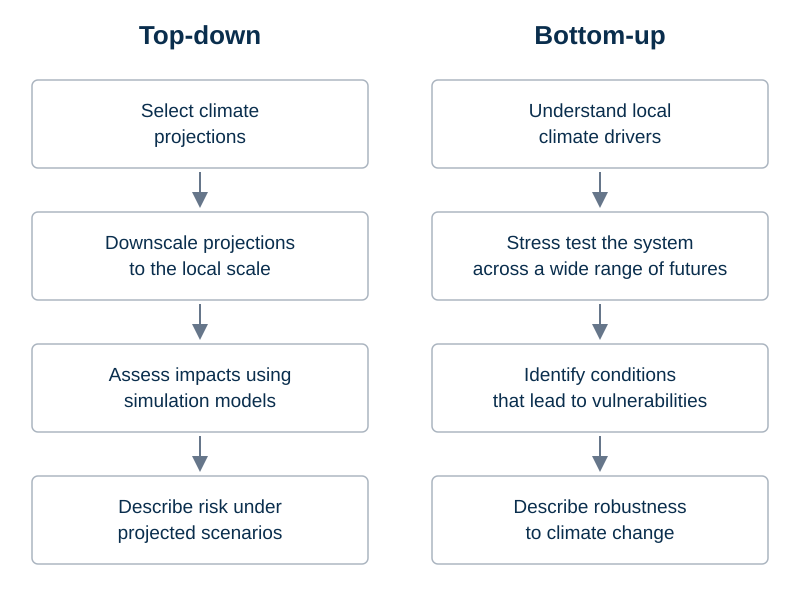

Climate risk assessments help water planners understand how changing climate conditions could affect
water supply, flood protection, ecosystems and infrastructure.
Two broad approaches differ in where the assessment begins.

**Top-down assessments** begin with climate projections, usually from global or regional climate models
under selected emissions pathways.
These projections are translated to the spatial and temporal scales needed by hydrological and
water-system models, often through downscaling and bias adjustment.
The resulting simulations describe impacts conditional on those projections.
This provides a physically informed view of possible future changes, but the vulnerabilities revealed
depend on the scenarios selected and the uncertainties represented in the modelling chain.
Conditions outside that sample may remain unexplored [@prudhomme2010; @brown2012].

**Bottom-up assessments** begin with the system and the decisions it must support: what services matter,
what constitutes unacceptable performance, and which conditions could cause that performance to deteriorate.
They explore a range of climate and, where relevant, non-climate stresses to identify vulnerabilities.
Climate projections then help interpret how those vulnerabilities relate to plausible future conditions.
This ordering focuses climate information on the questions that matter for the decision [@brown2012].

The approaches are complementary.
Climate models provide evidence about possible changes in the climate system; bottom-up analysis reveals
which changes matter to a particular water system.
Climate stress testing supplies the systematic sensitivity experiment within a bottom-up assessment.

The diagram below contrasts the sequence of steps in the two approaches.

