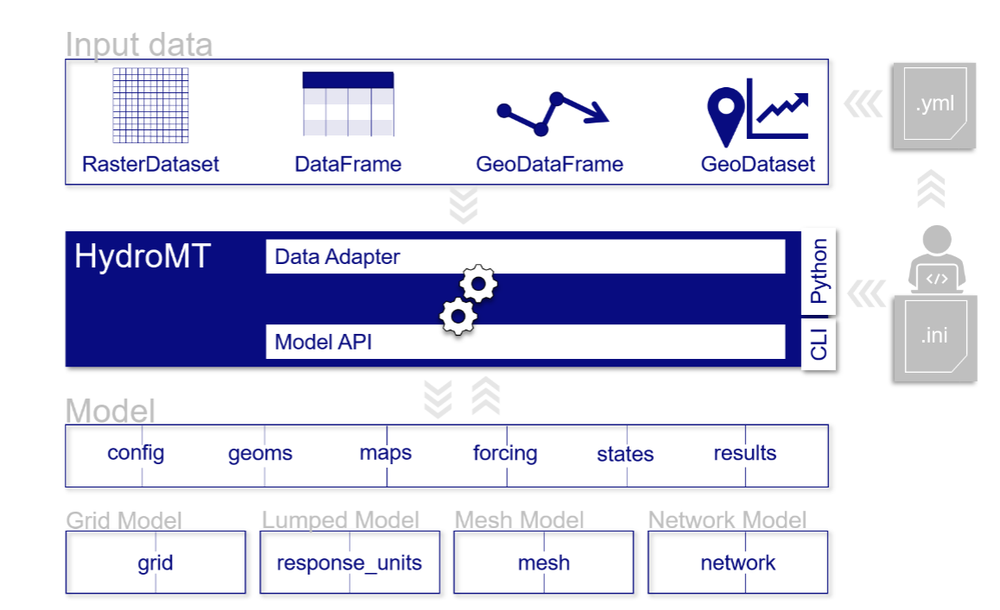

## Purpose and inputs

HydroMT is a Python framework for preparing spatial and time-series data for environmental models.
Its HydroMT-Wflow plugin translates those data into the maps, forcing and configuration required by
Wflow-SBM. It automates repeatable model preparation; Wflow itself performs the hydrological simulation.

For general model-building instructions and setup-method details, refer to the
[HydroMT manual](https://deltares.github.io/hydromt/stable/) and the
[HydroMT-Wflow manual](https://deltares.github.io/hydromt_wflow/latest/).
This page describes their use within the CST Toolbox.

The schematic below shows how HydroMT connects different data types to model components through its
data adapters and model interface. In the CST Toolbox, HydroMT-Wflow provides the model-specific setup.

{width=100% fig-alt="Raster, table and geospatial inputs pass through HydroMT data adapters and the model interface to configuration, geometries, maps, forcing, states and results." style="background-color: white;"}

Model preparation starts from the basin definition, model resolution, reporting locations and selected
data sources. Hydrography establishes the drainage structure, while land cover, vegetation and soil
data support parameter estimation. Lake, reservoir and glacier inventories supply additional features
where they intersect the basin and satisfy the model recipe's selection criteria. The
[Datasets](data-requirements.md) chapter describes these inputs and their limitations.

## Data preparation and model construction

The toolbox first establishes a shared basin, river network, subbasins and location registry. Climate
extraction and projection analysis use this same region without requiring a completed Wflow model.
Model construction then prepares the thematic spatial inputs and passes them to HydroMT-Wflow's
standard setup methods.

These methods derive river geometry and routing properties, translate land-cover classes into model
parameters, prepare seasonal leaf area index and estimate soil hydraulic properties. The supplied soil
recipe uses the Brakensiek pedotransfer relationship for vertical saturated hydraulic conductivity.
Other parameters are supplied as explicit constants in the model recipe. Waterbody and glacier setup,
forcing preparation and output-location configuration complete the model.

## From generated weather to Wflow forcing {#weather-to-forcing}

Wflow requires daily precipitation, temperature and potential evapotranspiration (PET) on its model
grid. Model building prepares these from the historical climate record; hydrological simulation prepares them
separately for each
generated scenario. For ERA5 and CHIRPS, HydroMT-Wflow calculates PET with the De Bruin method.
When CHIRPS supplies precipitation, ERA5 supplies the accompanying temperature, pressure and radiation.

**Carrying weather variables together.** scenario generation selects historical days to construct each
realization.
It applies the same day sequence to every variable and every cell of the extracted climate grid,
including the surrounding cells needed for regridding. Pressure and radiation therefore vary from
day to day and between realizations. They are resampled historical values, not fixed monthly averages
or independently generated weather. The subsequent perturbation changes precipitation and temperature
while leaving the associated pressure and radiation values unchanged.

| Quantity | Treatment in the supplied stress-test pathway |
|---|---|
| Precipitation | Resampled, then adjusted using the selected monthly mean and variance settings. |
| Mean, minimum and maximum temperature | Resampled, then given the selected monthly temperature offset. |
| Mean sea-level pressure (`press_msl`) | Resampled with the same historical days; no climate-change adjustment. |
| Incoming surface shortwave radiation (`kin`) | Resampled with the same historical days; no climate-change adjustment. |
| Top-of-atmosphere incident solar radiation (`kout`) | Carried from those historical days; not recalculated for synthetic dates. |

See [Weathergenr](weather-generation.md#climate-perturbations-and-temporal-trajectories) for the
perturbation settings and their default variance behavior.

**Preparing the model grid.** HydroMT-Wflow reprojects precipitation and temperature, corrects
temperature for differences between forcing-grid and model-grid elevation, and adjusts sea-level
pressure to model elevation. Hydrological simulation enables both temperature and pressure corrections and
supplies the
forcing source's elevation grid. HydroMT then computes PET from the adjusted temperature and pressure
and the resampled radiation. Wflow reads the resulting precipitation, temperature and PET fields.
The supplied generator recipe sets `compute_pet: false`; its Hargreaves option does not determine
the PET used by Wflow.

**What warming changes.** De Bruin PET depends on temperature through the saturation-vapour-pressure
curve, latent heat of vaporization and the psychrometric term, as well as on pressure and radiation.
PET is therefore recalculated after warming; it is not held fixed or multiplied by a prescribed
percentage. Precipitation is not a direct input to this PET calculation. For two scenarios using the
same realization and temperature settings, changing precipitation alone leaves PET unchanged, while
Wflow's actual evapotranspiration can change through water availability.

This experiment retains resampled historical radiation and pressure while imposing temperature and
rainfall changes. It does not prescribe future cloudiness or pressure changes, or explicitly represent
humidity and wind changes in the De Bruin calculation. The original same-day relationships are
retained during resampling but need not remain physically representative after large perturbations.
Review the simulated water balance with this assumption in mind. Enable `forcing_plots: true` in the
model-building YAML when model-grid forcing figures are needed alongside historical climate diagnostics.

## Assumptions and limitations

Parameter estimates reflect the source datasets, their mapping tables and the selected setup methods.
They are not fitted to local discharge observations by this workflow. For example, a land-cover class
provides a consistent basis for assigning vegetation properties, but it does not establish that those
properties represent a particular plantation, irrigated field or urban area accurately.

Review the prepared basin and model maps before relying on the historical simulation. Drainage-area
errors, misplaced reporting points and unsuitable waterbody attributes can affect results even when
model construction completes successfully. Changing source data or the build recipe may require a new
model and a renewed evaluation of its historical performance.
