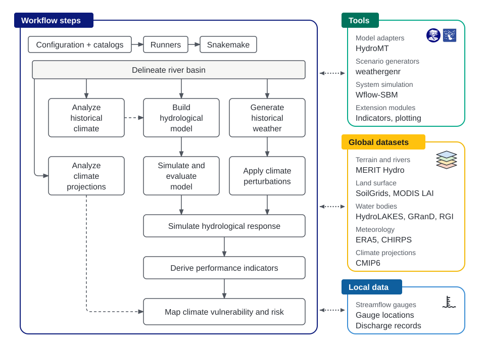

The CST Toolbox supports bottom-up climate risk assessment to understand water-system robustness under
an uncertain future. Its simulations and indicators help identify climate conditions under which water
availability, seasonal flows or hydrological extremes cross performance thresholds defined by the analyst.

## Assessment approach and toolbox structure {#components}

The decision context sets the geographical scope, objectives and criteria for the assessment. Historical
climate analysis establishes baseline variability and supports forcing selection; the selected record
then supports model evaluation and conditions the weather generator.

Stress testing brings together two branches shown below: the prepared hydrological model and generated
weather across analyst-defined temperature and precipitation changes. Simulated responses and indicators
reveal sensitivity to these changes. Climate projections provide context for interpreting the tested
conditions, without determining the scenarios or assigning them probabilities.

<figure>

[{fig-alt="A Workflow steps panel is linked by dotted two-way arrows to Tools, Global datasets and Local data panels. Configuration and catalogs feed runners and Snakemake. Delineate river basin feeds Analyze historical climate, Build hydrological model, Generate historical weather and Analyze climate projections. Historical climate analysis informs model building. The model branch (build, then simulate and evaluate) and the scenario branch (generate historical weather, then apply climate perturbations) converge on Simulate hydrological response, then Derive performance indicators, then Map climate vulnerability and risk, which climate projections inform as context only." width=100%}](assets/toolbox-conceptual-overview-illustrated.svg)

</figure>

Configuration files connect the assessment choices to the tools and datasets in the figure; runners
and Snakemake coordinate processing and retain execution records for reproducibility.

Models are built from global data without local calibration, so their suitability requires evaluation
against evidence relevant to the basin and intended use. Indicators support the analyst's assessment
of vulnerability and robustness; mapping risk and making decisions require interpretation and, where
needed, additional local evidence.

The toolbox produces climate diagnostics, simulated hydrological responses and indicator tables.
Constructing response surfaces, applying acceptability thresholds and comparing adaptation options
require further analysis of those results. The current User Guide explains
[how to connect indicators to climate conditions](../guide/outputs.md#join-an-indicator-to-its-climate-settings);
it does not yet provide a supported response-surface construction walkthrough. The
[Methodology](../site/scientific-approach/overview.qmd) places these calculations within the wider
assessment of water-system vulnerability and robustness.

## Scope and organization of the manual {#sections}

This manual is the primary reference for methods, settings and interpretation:

- [Models and tools](modeling-and-analysis.md): scientific methods and software components.
- [Data](data-requirements.md): datasets, access and input requirements.
- [Workflows](scientific-workflows.md): project structure and processing steps, with
  [shared configuration](shared-configuration.md) introducing common settings.
- [Execution and run management](configuration-and-execution.md): running, monitoring and reusing analyses.
- [Results, evaluation and interpretation](results-and-interpretation.md): outputs and their meaning.

Detailed references provide the [configuration rules](configuration.md),
[location matching and daily-response conventions](input-formats.md),
[indicator selection](indicator-requests.md), [saved-result tables](retained-handoffs.md),
[run records](execution-and-provenance.md), [resource measurements](runtime-and-resources.md),
[projection-result transfer](results-transfer.md) and [custom indicators](indicator-extension.md).

For installation and a first run, start with the [user guide](../guide/quick-start.md).
