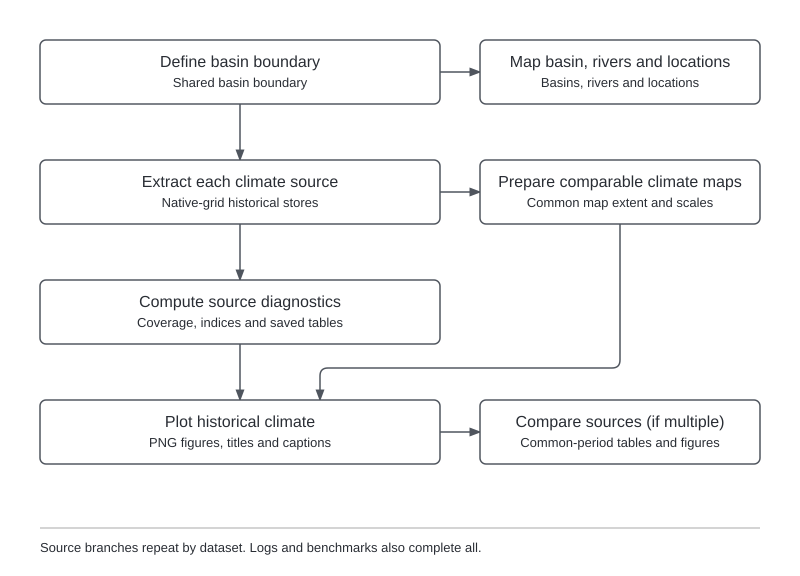

Historical climate analysis builds understanding of baseline climate variability and the climatic
context of hydrological conditions. It compares candidate gridded datasets to support forcing selection,
using maps, time series and diagnostics of coverage, seasonality and extremes.

## Inputs {#inputs}

- **Basin definition.** Geographical extent and analysis resolution specified in the project settings.
- **Historical climate data.** Candidate gridded datasets accessed through the
  [data catalogs](data-catalogs-and-access.md). The
  [dataset reference](historical-meteorological-data.md) lists first-version options and variable requirements.

See [input formats](data-formats-and-conventions.md) for file conventions.

Historical candidate datasets must supply at least 16 years. Source coverage can shorten the requested period;
extraction requires overlap between the source record and that period.

## Configuration {#configuration}

**Project settings** define the shared basin and climate inputs.

| Setting | Purpose |
|---|---|
| `basin.region`, `basin.resolution` | Basin extent and analysis resolution. |
| `climate.sources` | Candidate historical datasets to analyze. |
| `climate.forcing.precip_source` | Used by downstream forcing consumers; not required for comparisons. |
| `climate.window` | Requested historical period. |
| `climate.water_year_start` | Month that begins the reporting year. |

**Workflow settings** control the diagnostics and optional subbasin figures. The annotated template is
`config/templates/example-basin/project_config_analyze_climate.yml`.

| Setting | Purpose |
|---|---|
| `diagnostics.reference_period` | Reference water years for anomalies and SPI fitting. |
| `diagnostics.comparison_period` | Requested period for comparing sources. |
| `diagnostics.annual_spatial_anomalies` | Native-grid annual P/T departure panels; default `false`. |
| `diagnostics.max_missing_days_month` | Allowed missing days per month; default 3. |
| `diagnostics.max_missing_days_year` | Allowed missing days per water year; default 15. |
| `diagnostics.wet_day_threshold_mm` | Wet-day threshold; default 1 mm/day. |
| `diagnostics.spi_distribution` | SPI distribution: `gamma` (default) or `pearson3`. |
| `plotting.comparison` | Render basin comparison figures; default `true`. |
| `plotting.source` | Include individual-source copies of comparison figures; default `false`. |
| `plotting.location` | Render reporting-location and upstream-subbasin figures; default `false`. |

The reference period defaults to the climate window, and the comparison period defaults to the
reference period. Missing-day tolerances must match the project settings in `climate.map_reference`.
See [execution and run management](configuration-and-execution.md) for running the workflow.

Basin-average comparison figures and unique source maps remain on by default. With multiple sources,
individual-source figures duplicating those comparisons are omitted. A comparison includes temperature
when at least one source provides it; its legend identifies the contributing source. Unique source-specific
precipitation–temperature relationships remain. With one source, or comparison figures disabled, source
basin diagnostics remain on. Set `plotting.source: true` to restore individual-source copies.

Location and upstream-subbasin figures share `plotting.location`. Its default `false` preserves comparison
data and numerical tables. These figure switches accept booleans only and leave existing disabled PNGs
untouched; title and caption inventories describe the figures selected for the current run.

These switches belong under `plotting:` in this workflow's YAML; shared `plotting.annotation` stays in
the project YAML. Old `source_figures`, `location_figures` and `subbasin_figures` are accepted with
deprecation warnings. The latter two both map to `plotting.location`; conflicting declarations are errors.
Unknown keys and nonboolean switches are rejected. Comparison filenames omit the `comparison_` prefix.
Machine-readable figure inventories live under the dataset's `_engine/plots/`, with an `indices/`
subfolder for index metadata; readable title/caption Markdown stays beside the figures. Older retained
metadata remains readable in place.

Comparison `tables/basin-average/` exposes seven CSVs: `annual_indices`, `monthly_values`,
`precip_climatology`, `temp_climatology`, `drought_events`, `trends` and `agreement`. Supporting coverage,
fit checks, timing, SPI, spell, autocorrelation, homogeneity and sensitivity tables, plus `agreement.md`,
live under `_engine/basin-average/`. Calculations and rerendering retain all these data. Existing files
are preserved when switching layouts; new runs use the consolidated paths.

### Map annual departures {#annual-spatial-anomalies}

Set `diagnostics.annual_spatial_anomalies: true` in the historical analysis YAML to show where each
comparison reporting year was wetter, drier, warmer or cooler than the reference climate. This optional
product uses the existing reference/comparison periods, sources, reporting-year start and missing-day
tolerances. Omitted or `false` disables it; other types are rejected. Precipitation-only sources produce
precipitation panels without borrowed temperature. PET and percentage anomalies are outside this product.

For example, in `project_config_analyze_climate.yml`:

```yaml
diagnostics:
  reference_period:
    # First reference reporting year. Input: integer year, <= end.
    start: 2000
    # Last reference reporting year. Input: integer year, >= start.
    end: 2010
  comparison_period:
    # First comparison reporting year. Input: integer year, <= end.
    start: 2000
    # Last comparison reporting year. Input: integer year, >= start.
    end: 2016
  annual_spatial_anomalies: true
```

At each native cell, precipitation is the annual total (mm), temperature the daily annual mean (°C),
and the anomaly is that value minus its arithmetic reference mean. Reporting-year labels name the
starting year: an October year labelled 2000 spans October 2000 through September 2001. Missing dates
count as gaps. Eligible years allow the configured missing-day tolerances (defaults: three per month,
fifteen per year); tolerated gaps use that calendar month's observed mean for both variables. Set both
tolerances to zero, also in `climate.map_reference`, for strict no-infill summaries.

Only reference years fully contained in the stored daily span enter the baseline; excluded incomplete
or out-of-span years are reported. A cell needs a valid annual aggregate in **every** eligible reference year,
giving fixed reference support across all plotted years. No eligible reference year is an error. One eligible
year is allowed and identified explicitly; it does not constitute a climate normal. Invalid cell-years
and unavailable baselines remain missing. Every requested comparison year has a labelled panel,
including partial boundary years and wholly unavailable years.

Maps retain native cells and existing basin/subbasin/river overlays, including cells outside the basin
that intersect the displayed frame. No polygon mask, spatial averaging or regridding is applied. Each
variable uses one symmetric zero-centred scale across finite displayed cells of all candidate sources
and comparison years, without clipping. All-zero data use a disclosed display-only range of ±1 mm or
±1 °C; wholly unavailable data have no numerical key. Gray denotes missing cells, white uncovered area.
These are descriptive departures, not trends or significance estimates.

Each source store retains `tables/annual_spatial_anomalies.nc` with native annual values, anomalies,
reference means/counts and validity masks. `_engine/annual_spatial_anomalies.json` records settings,
source/input identity, requested/eligible/excluded years, exact dates, availability and page inventory.
Figures live directly under `plots/`, with filenames
`<source>_<variable>_annual_anomaly_map_basin.png`. Six chronological years fit in one multi-panel
figure. Longer periods produce multiple figures with suffixes `_page_01.png`, `_page_02.png`, etc.;
every requested year is included. Ordinary title/caption inventories and `plotting.annotation` modes apply.

Run the usual historical analysis entry point. Retained rerendering through
`scripts/render_figures.py wf0 --project <run> --out <review>` uses saved annual fields without
daily source data. Disabling the option or shortening the comparison period retires only previously
managed anomaly figures and their inventory entries, preserving unrelated files and retained data.
Rerunning also retires previously managed PNGs from the older `plots/annual_anomalies/page_001/`
layout after writing the replacement figures directly under `plots/`.

### Compare daily rain gauges {#rain-gauges}

Optionally set `rain_gauges` in the historical analysis YAML:

```yaml
rain_gauges:
  stations_path: data/rain_gauge_stations.csv
  precip_path: data/rain_gauge_precip.csv
  time_label: interval_end
```

Omission or `null` disables observation input; gridded per-location comparison calculations still run when
multiple candidates are selected. Their figures require `plotting.location: true`. A populated mapping
requires these three fields and accepts optional `temp_path`.
That CSV uses the same `time` and station-ID columns for daily mean temperature in degrees Celsius;
negative temperatures are valid. It uses the same time-label declaration as precipitation.
Schema 3 resolves paths beside that YAML; schema 2 keeps its existing invocation-relative base.
The station CSV requires `id,x,y`, with optional display `name` and elevation `elevtn` (metres).
IDs are unique nonempty strings, including leading zeros. Coordinates are finite WGS84 longitude and
latitude in degrees. Elevation is metadata only. The precipitation CSV has `time` followed by literal
station-ID columns, in millimetres per daily interval. Names never control joins. Blank cells and
missing rows are missing; zero is dry weather. Duplicate dates/columns, negative/non-numeric values,
infinity and non-midnight timestamps are rejected. Convert provider missing-value codes to blanks.

`interval_end` means midnight UTC ending the accumulated day: `2000-02-01` belongs to January 31.
`interval_start` labels are shifted forward one day before matching. Both declarations require actual
midnight-to-midnight UTC intervals; prepare other accumulation windows upstream. Relabelling a local
09:00 accumulation does not convert it. Extracted source stores retain their interval-end labels.
Clipping and month/reporting-year attribution use the preceding covered day, without modifying stores.
An extraction missing the last required interval leaves the period incomplete.

Every declared precipitation candidate is sampled with HydroMT native-cell point sampling, including
single-source comparisons. Stations must lie inside/on the basin and within the actual source grid.
Outside points, unmatched IDs and nodata cells are reported; there is no interpolation, nearest-valid
search, elevation adjustment or gap filling. Each station uses common valid dates across observations
and all candidates. Coverage retains individual counts, joint counts and the expected calendar.
Daily bias (source minus observed), MAE, RMSE and Pearson correlation use those same dates.
Percentage bias divides the summed difference by summed observations; zero denominators are unavailable.
Correlation is unavailable with fewer than two pairs or constant series.

Monthly and reporting-year totals require every actual day, including leap days. Reporting years use
start-year labels and `climate.water_year_start`. Monthly climatologies average the same complete months
for every series; `monthly.csv` retains contributing months for counting. These strict rules apply only
to per-location comparisons, including locations without gauges, and do not change basin diagnostics'
existing tolerated-gap summaries. Temperature summaries require complete matched periods independently
of precipitation and use means rather than totals.

Run the usual historical analysis entry point. The comparison area has two views:

```text
data/climate/historical/comparison/
  locations.csv
  plots/basin-average/
  plots/locations/<id>/
  tables/basin-average/
  tables/locations/<id>/
  _engine/
```

The basin-average view compares gridded basin means. The location view replaces the former comparison
`plots/subbasins/`: each dataset is sampled at the original coordinates of every declared spatial location
and rainfall-gauge site. These are native-cell values, not subbasin averages. The `plotting.location` switch
continues to control optional area-average diagnostics inside individual source stores.

`locations.csv` maps each directory ID to its name, coordinates, location role, spatial location code,
Wflow ID, associated subbasin and available observation columns. Declared locations use
`location_<wflow_id>`; gauge-only sites use `station_<safe-token>`, preserving literal gauge IDs in
`gauge_id`. A gauge joins an existing location only when its original coordinates coincide uniquely
within 1e-8 degrees; otherwise it retains a separate site. Gauges are never snapped to rivers for this
comparison. Outside-basin and outside-grid sites remain indexed with explicit exclusions.
An alternate temperature companion retains its true source label and its configured preparation;
its figures identify the retained extraction grid instead of claiming the original companion grid.

Each location has annual overlays and monthly climatology figures. Where
observations exist, a monthly agreement figure adds one panel per gridded dataset, common axis limits,
a 1:1 line, Pearson r and the number of complete paired months. Annual overlays and monthly panels adapt
the comparison forms of Figures 8–12 in *Development of a Climate Stress Test and Case Study for Zimbabwe*
(University of Cincinnati, draft final report to UNESCO, 24 November 2021), using CST presets.
Temperature annual means and climatologies use only genuine temperature carriers; monthly agreement requires
`temp_path`. The temperature scatter explicitly compares monthly means. Correlation includes the seasonal
cycle and does not measure anomaly skill or establish accuracy.

Precipitation monthly-coverage plots are omitted throughout historical climate analysis. Coverage and
completeness remain available in the retained tables.

Per-location tables retain coverage, daily agreement, monthly/annual precipitation, native-cell
coordinates/CRS, exclusions and optional temperature means. Monthly agreement metrics retain paired-month
counts, Pearson r, mean bias and RMSE; precipitation errors are in mm/month and temperature errors in °C.
Figures show unavailable comparisons explicitly. Each location's plot directory contains readable
`figure_titles.md` and `figure_captions.md`; sampled daily data live under `_engine/locations/` and
machine figure inventories under `_engine/plots/locations/`. Basin figure inventories live under `_engine/basin-average/`.

Rerender both views with
`scripts/render_figures.py wf0-comparison --project <run> --out <review>`.
The `rain-gauges` family renders the location view for new runs and continues reading legacy
`comparison/stations/` or `historical/rain_gauges/` products. Older flat basin tables are readable by the
comparison rerender command. Rerunning historical analysis writes the new layout; obsolete generated
directories from earlier runs should be retired separately after verifying the replacement products.

This comparison supports forcing choice; it does not select or correct forcing. Point/grid support
differs, and gridded products may already incorporate these observations, so agreement is not independent
validation. The starter's two CSVs illustrate the format with synthetic values.

## Processing sequence {#rule-flow}

{width=100% fig-alt="Scientific processing from basin and climate inputs to the assessment products described in this section."}

The workflow prepares basin boundaries, extracts each dataset and calculates diagnostics. Maps retain
each source's native grid with shared display scales. Multiple sources are compared over their common
available period; subbasin results follow the same processing steps when enabled.

## Outputs {#outputs}

Results are saved under `data/climate/historical/`, relative to `project_dir`, with a separate folder
for each source. The main outputs are:

- **Diagnostic tables (`tables/`).** Coverage, climate indices, drought events and trend diagnostics,
  including daily basin series in `daily_basin.csv` and annual climatology in `annual_climatology.nc`.
- **Maps and time-series figures (`plots/`).** Precipitation, temperature and potential
  evapotranspiration where available, with titles and captions.
- **Source comparisons (`comparison/`).** Basin-average tables and figures under
  `tables/basin-average/` and `plots/basin-average/`, including `agreement.csv` and `agreement.md`.
  Per-location tables and figures under `tables/locations/<id>/` and `plots/locations/<id>/` include
  observations when available; `locations.csv` indexes every site.
- **Subbasin results (`tables/subbasins/` and `plots/subbasins/`).** Additional tables and figures when
  `plotting.location: true`. Basin maps show subbasin outlines regardless of this setting.
- **Diagnostic record (`_engine/diagnostics.json`).** Methods, data availability and provenance.

Two shared outputs support the analysis:

- **Basin geometry (`data/spatial/`).** GeoJSON basin, subbasin, river and location vectors.
- **Map reference (`data/climate/historical/_engine/map_reference.json`).** Shared display extent and
  color classes, also used by model building.

Map preparation identities normalize Python source line endings to LF, so equivalent Windows
checkouts share code hashes. Input data, catalogs and environment locks retain byte-exact hashes.
After upgrading from byte-exact Python hashes, regenerate the prepared fields once. If WF0 reports
`stale preparation identity`, run the single-workflow runner with your usual config and project
directory, targeting `--target produce_historical_map_reference` and forwarding
`-- --forcerun prepare_historical_map_fields_era5 prepare_historical_map_fields_chirps`
(include only sources declared in your project). Preview with `--dry-run`, execute without it,
then resume the normal workflow command. This rebuilds map fields and their reference without
forcing climate extraction.

Displayed maps zoom to the basin bounds with spatial-map padding, clipped to each source grid's
outer cell edges. Without basin geometry, they retain the reference frame.

Figure availability depends on source variables and usable data. PNG filenames follow
`<dataset>_<variable>_<context>_<spatial_scope>.png`; `plotting.annotation` controls whether figures
display a title, caption or neither.

## Diagnostics and interpretation {#interpretation}

- **Coverage.** Record completeness determines which periods can support climate diagnostics and fair
  comparisons between datasets. Missing-day tolerances identify usable months and years, while source
  comparisons use their common available record.
- **Seasonality and anomalies.** Seasonal rainfall and temperature patterns help explain the timing of
  water availability, while anomalies identify departures from typical conditions. Monthly totals and
  means describe the seasonal cycle; anomalies are calculated against reference-month means.
- **SPI and drought events.** Precipitation deficits over different durations help characterize the
  climatic conditions associated with drought. The Standardized Precipitation Index (SPI) standardizes
  3-, 6- and 12-month rainfall accumulations against the reference climate to identify dry periods and
  summarize their duration and severity.
- **Rainfall extremes and dry spells.** Heavy rainfall and extended rain-free periods help characterize
  climatic pressures associated with flooding and water shortages. Annual maximum one- and five-day
  rainfall, mean wet-day intensity and consecutive dry-day durations summarize these features.
- **Persistence.** Persistence indicates whether wet or dry conditions tend to continue across months,
  which matters for prolonged water deficits or surpluses. Autocorrelation of monthly precipitation
  anomalies measures this dependence at lags of 1–12 months.
- **Trends.** Historical trends help assess whether the baseline climate has changed over the record.
  Theil–Sen slopes estimate change per decade, and start-year sensitivity tests how strongly that
  estimate depends on the selected period.

SPI distribution-fit diagnostics remain available in the retained `spi_fit_checks` table; WF0 does
not emit a separate reference-period normality-check figure.

See the [processing rule reference](workflow-rule-reference.md#analyze-climate) for individual steps.

## Optional daily climate indices {#climate-indices}

Set `diagnostics.climate_indices.enabled: true` in the historical-analysis workflow file to calculate
both native-grid indices and indices of the daily basin series. This bundle is disabled by default
because cellwise percentile bootstrap and event retention can be expensive. The configuration starter
contains the settings; `reference_period: null` uses complete calendar years from `climate.window`.
An explicit `{start: 1991, end: 2020}` selects reference calendar years independently of the existing
`diagnostics.reference_period`, which controls water-year anomalies and SPI. Requested reference years
outside the extracted record count as missing; they do not trigger additional acquisition.

`diagnostics.climate_indices.seasons` maps names to ordered contiguous month lists, for example
`{DJF: [12, 1, 2], JJA: [6, 7, 8]}`. No seasons are inferred. Annual periods use the configured water-year
start; annual and seasonal labels use their start year. December 2000–February 2001 is `DJF:2000`.

### Definitions and reference conventions

Daily precipitation is in mm/day and TX/TN are daily maximum/minimum temperature in °C. Wet days have
precipitation at least `diagnostics.wet_day_threshold_mm` (default 1 mm). TX/TN indices require verified
source-owned extrema; mean temperature is not substituted. Mean-temperature counts separately require
the source's actual daily `temp` variable, not an estimate from TX/TN. CHIRPS remains precipitation-only
even when its forcing store contains ERA5 companion temperatures.

| Product | Definition |
|---|---|
| CDD, CWD | Longest observed dry/wet run overlapping the reporting period, in days. |
| Wet-spell mean, median, p90 | Full lengths of complete wet events starting in the period. |
| R10mm, R20mm | Number of days with precipitation ≥10 or ≥20 mm. |
| Rx1day, Rx5day | Maximum daily or complete consecutive five-day rainfall within the period. |
| PRCPTOT, wet days, SDII | Wet-day total, count, and total divided by count. |
| R95p amount | Sum of daily rainfall strictly exceeding the reference wet-day 95th percentile. |
| R95p fraction | R95p amount divided by period wet-day rainfall, in percent; undefined at zero rainfall. |
| TXx, TNx | Maximum daily maximum/minimum temperature in the period. |
| Mean-temperature counts | Days with daily mean T <0°C, and T above the configured threshold (default 25°C). |
| TX90p, TN90p | Percentage of valid days strictly above the calendar-day reference 90th percentile. |
| WSDI | Days overlapping the period in fixed-reference TX exceedance runs of at least six days. |
| Heatwave days, longest heatwave | Total and maximum overlapping days in TX exceedance runs ≥3 days. |
| Heatwave count | Number of qualifying events starting in the period, when their count is known. |

The mean-temperature counts adapt the FAO branch's two temperature-count diagnostics, retaining strict
comparisons and its 25°C default. Configure the upper boundary with
`diagnostics.climate_indices.mean_temperature_threshold_degc`; it must be finite. These products are
`mean_temp_below_zero_days` and `mean_temp_above_threshold_days`. They are not minimum-temperature frost
days, maximum-temperature summer days or heatwave events. They count observed qualifying days without
missing-day scaling, use the same period-eligibility rules as other absolute indices, and need no
percentile reference support or bootstrap. The boundary is retained in NetCDF attributes, publication
identity, captions and figure labels. Both annual and configured-season results are produced.

Percentiles use Hyndman–Fan type 8. Precipitation thresholds pool reference wet days. Temperature uses
a five-day calendar window, circular within each reference year. February 29 is excluded from fitting
and uses February 28's threshold during evaluation. These calendar choices follow the
[PCIC implementation](https://github.com/pacificclimate/climdex.pcic); they are explicitly implemented
here rather than assumed equivalent to other packages' defaults.

For TX90p/TN90p within reference years, replace the evaluated reference year with each other reference
year in turn, evaluate the original daily observations, then average exceedance indicators. Out-of-reference
evaluation uses the retained full-reference thresholds. This also supports evaluation wholly inside the
reference period. All replacement replicates must have adequate support; failed replicates are not dropped.
WSDI and the three-day heatwave adaptation use fixed thresholds throughout so their day totals reconcile
with one event catalogue. They are not bootstrap-adjusted WSDI or extended-summer Climpact heatwaves.

`reference_minimum_fraction` defaults to 0.9, a toolbox quality choice rather than a universal ETCCDI rule.
Temperature thresholds need that fraction of expected five-day samples and at least two contributing
years; precipitation needs that fraction of reference observations and at least two wet days. At least
two reference years are required, but short references remain exploratory. Retained reference files
include thresholds, sample support, contributing temperature years and the temperature reference samples.

### Missingness, events and spatial meaning

Missing days break runs and never become dry days. Events are detected on the continuous retained record
before periods are sliced. The catalogue stores inclusive start/end dates, full observed duration,
censoring and heat-event mean/peak temperature. Period day totals use overlap; event counts use starts.
Unknown observations or an overlapping censored heatwave make the physical event count unavailable.
Censored duration metrics are lower bounds; complete-event distributions exclude censored segments and
can therefore be biased toward shorter events. No complete wet spells gives undefined duration summaries.

Period eligibility uses the existing monthly and yearly missing-day tolerances (the yearly tolerance
also applies to a configured season). Absent period edges count as missing. Eligible periods use observed
values without infilling. Reference support is assessed separately. NetCDFs retain valid/expected days
and eligibility per variable; unavailable or undefined values are NaN. Exact threshold equality never
counts as percentile exceedance. The event catalogue spans the full extracted record, including portions
outside the requested reporting periods.

Basin series are equal-weight means of available basin cells each day; contributing-cell counts are
retained. Their indices differ from spatial means of cellwise indices. Basin and upstream-subbasin
indices use daily equal-weight means of available native cells before index calculation. Locations
sample the native cell containing their original coordinates. These are meteorological pressures, not flood
impacts or hydrological drought measurements.

### Retained products and reruns

Each source writes one `tables/climate_indices.csv` containing all registered indices for basin,
upstream subbasins and configured locations, for annual and configured seasonal periods. Rows retain
support identifiers, units, availability and missing-value reasons, including unavailable source variables
and out-of-domain locations. Original daily extraction and source-level `basin_cells.csv` remain the
calculation inputs. Existing diagnostic tables keep their previous formulas and precipitation totals.

Only `_engine/climate_indices.json` (settings, input/code fingerprints and product hashes) and
`_engine/figure_data/wet_spell_exceedance.csv` (basin plotting data) support this CSV. New calculations retain no
gridded index arrays, threshold arrays, event catalogues or daily contributing-cell counts, and create
no hashed directories. Changed inputs/settings recalculate from the daily source in memory. Products
are staged before replacement; the record is published last. Readers verify code and product hashes.
Legacy bundles remain readable and are preserved; this change does not delete existing case evidence.

Figures under `plots/indices/` split annual and configured-season basin panels into dry/wet spells,
heavy rainfall, rainfall amount and frequency, temperature extremes, and heatwaves. Only available
indices and scopes are emitted, alongside complete wet-spell exceedance when available. Spatial index
maps are no longer generated.
Compact sheets share unit labels within compatible rows and year titles by column. Single-source plots
omit empty boundary periods while preserving internal gaps. `figure_availability.json` lists emitted
PNGs and omitted indices; the adjacent captions JSON records interpretation and evaluation identity.
The workflow owns this directory as one availability-dependent rendering product. Previously inventoried
index maps are retired after successful rendering; unrelated files are preserved. Comparison tables do not acquire new
climate-index columns.
The retained-source mode of `scripts/render_figures.py` also renders enabled index bundles into its
separate output directory, preserving the original publication and its reference.

Calculation and input-drift failures preserve previous outputs. An interruption during replacement can
leave inconsistent products; checksum verification stops rendering until recalculation. Snakemake
declares the CSV, record and small plotting table separately, so missing products
are scheduled again. Long reference periods need substantial compute and memory; no locations are
silently sampled or capped.
