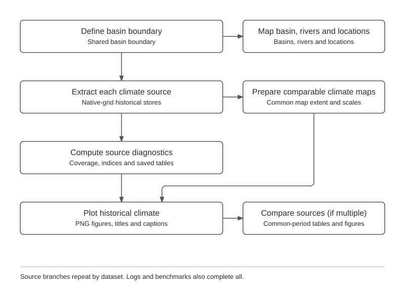

Historical climate analysis builds understanding of baseline climate variability and the climatic
context of hydrological conditions. It compares candidate gridded datasets to support forcing selection,
using maps, time series and diagnostics of coverage, seasonality and extremes.

## Inputs {#inputs}

- **Basin definition.** Geographical extent and analysis resolution specified in the project settings.
- **Historical climate data.** Candidate gridded datasets accessed through the
  [data catalogs](data-catalogs-and-access.md). The
  [dataset reference](historical-meteorological-data.md) lists first-version options and variable requirements.

See [input formats](data-formats-and-conventions.md) for file conventions.

Historical candidate datasets must supply at least 16 years. Source coverage can shorten the requested period;
extraction requires overlap between the source record and that period.

## Configuration {#configuration}

Project settings define the shared basin and climate inputs; workflow settings control the diagnostics and
optional subbasin figures. The annotated template is
`config/templates/example-basin/project_config_analyze_climate.yml`. See
[execution and run management](configuration-and-execution.md) for running the workflow.

### Project settings

| Setting | Purpose |
|---|---|
| `basin.region`, `basin.resolution` | Basin extent and analysis resolution. |
| `climate.forcings` | Forcing sets; each dataset they use is analyzed once per variable. |
| `climate.default_forcing` | Used by the workflows that read the forcing; not required for comparisons. |
| `climate.window` | Requested historical period. |
| `climate.water_year_start` | Month that begins the reporting year. |
| `climate.seasons` | Seasons for climate indices; default DJF, MAM, JJA, SON; `{}` for annual only. |
| `climate.map_reference` | Missing-day tolerances, shared with the map reference; default 3 per month, 15 per year. |

### Workflow settings

| Setting | Purpose |
|---|---|
| `diagnostics.reference_period` | Reference water years for anomalies, SPI fitting and climate indices. |
| `diagnostics.comparison_period` | Requested period for comparing sources. |
| `diagnostics.wet_day_threshold_mm` | Wet-day threshold; default 1 mm/day. |
| `diagnostics.spi_distribution` | SPI distribution: `gamma` (default) or `pearson3`. |
| `plotting.view` | `comparison` (default) overlays datasets; `individual` draws one figure per dataset; `both` draws both. |
| `plotting.scales` | `[basin]` (default) or `[basin, locations]` to add reporting-location and upstream-subbasin figures. |
| `plotting.annual_anomaly_maps` | Native-grid annual P/T departure panels; default `false`. |

The reference period defaults to the climate window, and the comparison period defaults to the
reference period. Missing-day tolerances come from `climate.map_reference` and seasons from
`climate.seasons` in the project file; the precipitation–temperature diagnostics always use ERA5
temperature. Earlier keys in this file are refused; see
[renamed settings](changes-and-migration.md#renamed-configuration-settings).

### Figure selection

- Basin-average comparison figures and unique source maps stay on by default.
- With multiple sources, individual-source figures that duplicate those comparisons are omitted. With one
  source, or `view: individual`, source basin diagnostics stay on. Set `view: both` to add individual-source
  copies of the comparisons.
- A comparison includes temperature when at least one source provides it; its legend identifies the
  contributing source. Unique source-specific precipitation–temperature relationships remain.
- Location and upstream-subbasin figures need `locations` in `plotting.scales`. Comparison data and numerical
  tables, including subbasin tables, are computed either way. Basin-scale figures always render, so `scales`
  must include `basin`.
- Changing these settings leaves existing disabled PNGs untouched; title and caption inventories describe the
  figures selected for the current run.

These switches belong under `plotting:` in this workflow's YAML; shared `plotting.annotation` stays in the
project YAML. Unknown keys are rejected.

Comparison filenames omit the `comparison_` prefix. Machine-readable figure inventories live under the
dataset's `_engine/plots/`, with an `indices/` subfolder for index metadata; readable title/caption Markdown
stays beside the figures.

### Result tables

Each dataset's `tables/` and the comparison's `tables/basin_average/` hold the same tables, one per
kind of result:

| File | Holds |
|---|---|
| `annual.csv` | per reporting year: indices (`total`, `wet_days`, `sdii`, `Rx1day`, `Rx5day`), completeness (`full_year`, `valid_precip`, `valid_temp`, `missing_days`, `reason`) and rainfall timing (`day_25`, `day_50`, `day_75`) |
| `monthly.csv` | per month: totals, reference mean, anomaly, temperature mean and coverage (`fraction`, `missing_days`, `class`) |
| `climatology.csv` | monthly climatology, with a `variable` column (`precip`, `temp`) |
| `spi.csv`, `drought_events.csv`, `trends.csv` | SPI series, drought events and trend tests |
| `supporting/` | `homogeneity.csv`, `spi_fit_checks.csv`, `dry_spells.csv` |

The comparison adds `agreement.csv`, which lists the common valid years. Data kept only to draw a figure
(dry-spell exceedance, anomaly autocorrelation, P–T anomalies, trend sensitivity) is in
`_engine/figure_data/`.

### Map annual departures {#annual-spatial-anomalies}

Set `diagnostics.annual_spatial_anomalies: true` in the historical analysis YAML to show where each
comparison reporting year was wetter, drier, warmer or cooler than the reference climate. Omitted or `false`
disables it; other types are rejected. For example, in `project_config_analyze_climate.yml`:

```yaml
diagnostics:
  reference_period:
    # First reference reporting year. Input: integer year, <= end.
    start: 2000
    # Last reference reporting year. Input: integer year, >= start.
    end: 2010
  comparison_period:
    # First comparison reporting year. Input: integer year, <= end.
    start: 2000
    # Last comparison reporting year. Input: integer year, >= start.
    end: 2016
  annual_spatial_anomalies: true
```

#### Calculation

This optional product uses the existing reference/comparison periods, sources, reporting-year start and
missing-day tolerances. Precipitation-only sources produce precipitation panels without borrowed temperature.
PET and percentage anomalies are outside this product.

At each native cell, precipitation is the annual total (mm), temperature the daily annual mean (°C), and the
anomaly is that value minus its arithmetic reference mean. Reporting-year labels name the starting year: an
October year labelled 2000 spans October 2000 through September 2001.

Missing dates count as gaps. Eligible years allow the configured missing-day tolerances (defaults: three per
month, fifteen per year); tolerated gaps use that calendar month's observed mean for both variables. Set both
tolerances to zero, also in `climate.map_reference`, for strict no-infill summaries.

#### Reference years

- Only reference years fully contained in the stored daily span enter the baseline; excluded incomplete or
  out-of-span years are reported.
- A cell needs a valid annual aggregate in **every** eligible reference year, giving fixed reference support
  across all plotted years.
- No eligible reference year is an error. One eligible year is allowed and identified explicitly; it does not
  constitute a climate normal.
- Invalid cell-years and unavailable baselines remain missing. Every requested comparison year has a labelled
  panel, including partial boundary years and wholly unavailable years.

#### Map display

Maps keep native cells and existing basin/subbasin/river overlays, including cells outside the basin that
intersect the displayed frame. No polygon mask, spatial averaging or regridding is applied.

Each variable uses one symmetric zero-centred scale across finite displayed cells of all candidate sources and
comparison years, without clipping. All-zero data use a disclosed display-only range of ±1 mm or ±1 °C; wholly
unavailable data have no numerical key. Gray denotes missing cells, white uncovered area. These are
descriptive departures, not trends or significance estimates.

#### Saved files

| File | Contents |
|---|---|
| `tables/annual_spatial_anomalies.nc` | Native annual values, anomalies, reference means/counts and validity masks, per source store |
| `_engine/annual_spatial_anomalies.json` | Settings, sources and inputs used, requested/eligible/excluded years, exact dates, availability and page inventory |
| `plots/<source>_<variable>_annual_anomaly_map_basin.png` | Figures, directly under `plots/` |

Six chronological years fit in one multi-panel figure. Longer periods produce multiple figures with suffixes
`_page_01.png`, `_page_02.png`, etc.; every requested year is included. Ordinary title/caption inventories and
`plotting.annotation` modes apply.

#### Reruns

Run the usual historical analysis entry point. Saved-run rerendering through
`scripts/render_figures.py wf0 --project <run> --out <review>` uses saved annual fields without daily source
data. Disabling the option or shortening the comparison period retires only previously managed anomaly figures
and their inventory entries, preserving unrelated files and saved data.

### Compare daily rain gauges {#rain-gauges}

[]{#settings}[]{#input-files}[]{#time-labels}[]{#sampling-and-scores}[]{#monthly-and-annual-totals}
[]{#comparison-layout}[]{#location-index}[]{#location-figures}[]{#location-tables-and-records}[]{#rerendering}
[]{#limits}

Optionally set `observations.met_stations` in the project file to compare daily rain gauges with the
gridded datasets. See [rain-gauge comparison](rain-gauge-comparison.md).

## Processing sequence {#rule-flow}

{width=100% fig-alt="Scientific processing from basin and climate inputs to the assessment products described in this section."}

The workflow prepares basin boundaries, extracts each dataset and calculates diagnostics. Maps keep
each source's native grid with shared display scales. Multiple sources are compared over their common
available period; subbasin results follow the same processing steps when enabled.

## Outputs {#outputs}

Results are saved under `data/climate/historical/` in the output directory, with a separate folder for each
source. Two shared outputs support the analysis.

### Main outputs

- **Diagnostic tables (`tables/`).** Annual, monthly and climatology tables, SPI, drought events and
  trends, with checks under `tables/supporting/`; also daily basin series in `daily_basin.csv` and annual
  climatology in `annual_climatology.nc`.
- **Maps and time-series figures (`plots/`).** Precipitation, temperature and potential
  evapotranspiration where available, with titles and captions.
- **Source comparisons (`source_comparison/`).** Basin-average tables and figures under
  `tables/basin_average/` and `plots/basin_average/`, including `agreement.csv`. Location tables under
  `tables/locations/` (one row set per `location_id`) and figures under `plots/locations/<id>/` include
  observations when available; `locations.csv` indexes every site.
- **Subbasin results (`tables/subbasins/` and `plots/subbasins/`).** Tables always; figures when
  `plotting.scales` includes `locations`. Basin maps show subbasin outlines regardless of this setting.
- **Diagnostic record (`_engine/diagnostics.json`).** Methods, data availability and data sources.

### Shared outputs

- **Basin geometry (`data/spatial/`).** GeoJSON basin, subbasin, river and location vectors.
- **Map reference (`data/climate/historical/_engine/map_reference.json`).** Shared display extent and
  color classes, also used by model building.

### Map preparation records

If historical climate analysis reports `stale preparation identity`, follow
[map preparation after an upgrade](changes-and-migration.md#map-preparation-after-an-upgrade).

### Map display and file names

Displayed maps zoom to the basin bounds with spatial-map padding, clipped to each source grid's outer cell
edges. Without basin geometry, they keep the reference frame.

Figure availability depends on source variables and usable data. PNG filenames follow
`<dataset>_<variable>_<context>_<spatial_scope>.png`; `plotting.annotation` controls whether figures display a
title, caption or neither.

## Diagnostics and interpretation {#interpretation}

- **Coverage.** Record completeness determines which periods can support climate diagnostics and fair
  comparisons between datasets. Missing-day tolerances identify usable months and years, while source
  comparisons use their common available record.
- **Seasonality and anomalies.** Seasonal rainfall and temperature patterns help explain the timing of
  water availability, while anomalies identify departures from typical conditions. Monthly totals and
  means describe the seasonal cycle; anomalies are calculated against reference-month means.
- **SPI and drought events.** Precipitation deficits over different durations help characterize the
  climatic conditions associated with drought. The Standardized Precipitation Index (SPI) standardizes
  3-, 6- and 12-month rainfall accumulations against the reference climate to identify dry periods and
  summarize their duration and severity.
- **Rainfall extremes and dry spells.** Heavy rainfall and extended rain-free periods help characterize
  climatic pressures associated with flooding and water shortages. Annual maximum one- and five-day
  rainfall, mean wet-day intensity and consecutive dry-day durations summarize these features.
- **Persistence.** Persistence indicates whether wet or dry conditions tend to continue across months,
  which matters for prolonged water deficits or surpluses. Autocorrelation of monthly precipitation
  anomalies measures this dependence at lags of 1–12 months.
- **Trends.** Historical trends help assess whether the baseline climate has changed over the record.
  Theil–Sen slopes estimate change per decade, and start-year sensitivity tests how strongly that
  estimate depends on the selected period.

SPI distribution-fit diagnostics remain available in the saved `spi_fit_checks` table; the workflow does
not emit a separate reference-period normality-check figure.

See the [processing rule reference](workflow-rule-reference.md#analyze-climate) for individual steps.

## Optional daily climate indices {#climate-indices}

[]{#definitions-and-reference-conventions}[]{#mean-temperature-counts}[]{#percentile-thresholds}
[]{#evaluation-inside-the-reference-period}[]{#reference-support}[]{#missingness-events-and-spatial-meaning}
[]{#retained-products-and-reruns}[]{#index-table}[]{#supporting-records}[]{#index-figures}
[]{#failures-and-compute}

Set `diagnostics.climate_indices.enabled: true` in the historical-analysis workflow file to calculate
native-grid indices and indices of the daily basin series. See [daily climate indices](climate-indices.md).
