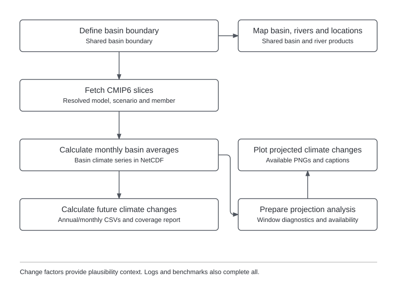

Projection analysis places the chosen stress-test range in the context of projected climate changes.
It compares basin-average temperature and precipitation between historical and future periods across
selected models and emissions scenarios. The results provide context for interpretation without
determining the weather scenarios used in the stress test.

The run-settings block lists analysis variables by short name, selected calculation methods and
area-weighted aggregation. It shows up to three climate model names with the total model count.
Ensemble counts use resolved model–member pairs without counting members again for each scenario;
larger ensembles show the member-count range per model. Scenario-dependent membership is flagged.

## Inputs {#inputs}

- **Basin definition.** Geographical extent used to calculate basin-average climate changes.
- **Climate projections.** Historical and future climate data for selected models, scenarios and members;
  see the [dataset reference](climate-projection-data.md) for current support.
- **Projection catalog.** Data-access information for the selected ensemble, currently provided through
  the [CMIP6 catalog](catalog-climate-projections.md).

A hydrological model and historical-forcing extraction are not required.

Missing period coverage is reported for each combination, and usable combinations can continue.
If none are usable, change-factor tables contain headers only; corrupt data and incompatible
calendars remain errors.

### Excluded model

Climate-projection analysis excludes CMIP6 `THU/CIESM` completely, across all variables, experiments and
members, because its published precipitation has an invalid scale. Excluding the whole model keeps the
ensemble consistent across variables; it does not establish a defect in temperature. See
[Monerie (2026), section 4](https://doi.org/10.1088/2515-7620/ae661c) for independent evidence of the
precipitation problem.

- Requested CIESM combinations remain in coverage and composition records as `source_quality_excluded`, with
  the reason and counts, but create no acquisition jobs and contribute to no analysis or change-factor
  products.
- Member overrides cannot restore the model. No speculative rescaling is applied.
- Existing source caches are preserved; rerunning projection analysis rebuilds affected derived products using
  the reduced ensemble.
- A request containing only excluded models fails with no resolved combinations.

## Configuration {#configuration}

**Project settings** define the basin through `basin.region` and `basin.resolution`.

**Workflow settings** define the projection ensemble and comparison periods. The annotated template is
`config/templates/example-basin/project_config_analyze_projections.yml`.

| Setting | Purpose |
|---|---|
| `ensemble` | Projection ensemble name, currently `cmip6`. |
| `projections_catalog` | Optional projection catalog; default the generated `toolbox:config/catalogs/cmip6_data.yml`. |
| `models`, `scenarios` | Climate models and emissions scenarios. |
| `members.preference` | Preferred ensemble members. |
| `members.selection`, `members.overrides` | Optional member-selection refinements. |
| `reference_period` | Historical reference calendar years; default `climate.window`, cut back to 2014. |
| `future_periods` | Future periods keyed by output label, e.g. `{mid: {start: 2046, end: 2054}}`. |
| `variables` | List of variables to analyse, e.g. `[precip, temp]`. |
| `variable_options` | Per-variable settings: derived-variable methods or a custom variable's full declaration. |
| `stats` | Summary statistics. |

Each projection is compared with its own modeled historical reference, independently of the observed
record used for model building. Temperature changes are additive in °C; precipitation changes are
relative. Seasonal results use DJF, MAM, JJA and SON; `climate.seasons` does not apply here yet.
Earlier keys are refused; see [renamed settings](changes-and-migration.md#renamed-configuration-settings).
See [execution and run management](configuration-and-execution.md) for running the workflow.

A custom variable is listed in `variables` and declared under `variable_options` with `source` (the
catalog's renamed variable), `canonical` (`rate` or `state`), `units` and `change` (`relative` or
`absolute`):

```yaml
variables: [precip, temp, tmax]
variable_options:
  tmax: {source: tmax, canonical: state, units: degC, change: absolute}
```

### Optional projected PET

[]{#selecting-pet}[]{#required-inputs}[]{#calculation}[]{#spatial-averaging}[]{#change-reporting}
[]{#saved-products}[]{#reruns}

List `pet` in `variables` and set `variable_options.pet: {method: makkink}` to estimate PET. See
[projected PET](projected-derived-variables.md#pet).

### Optional projected dew point and wind

[]{#selecting-the-variables}[]{#dew-point}[]{#wind-speed}[]{#spatial-averaging-and-support}
[]{#saved-products-and-records}[]{#reruns-and-qualification}

List `tdew` and/or `wind` in `variables` and set their `method` under `variable_options`. See
[projected dew point and wind](projected-derived-variables.md#dew-point-and-wind).

## Processing sequence {#rule-flow}

{width=100% fig-alt="Scientific processing from basin and climate inputs to the assessment products described in this section."}

The workflow acquires available climate projections, calculates monthly basin averages and compares
historical and future periods. It then prepares diagnostic tables and figures; historical series can
serve several future scenarios. Data availability determines which comparisons can be produced.

## Outputs {#outputs}

Results are saved under `data/climate/projections/<ensemble>/` in the output directory.

### Main outputs

- **Climate data (`raw/` and `scalar/`).** Downloaded NetCDF grids and monthly basin-average series.
- **Change factors (`summary/`).** Annual and monthly changes in
  `<ensemble>_change_factors_annual.csv` and `<ensemble>_change_factors_monthly.csv`.
- **Coverage report (`report.md` and `summary/composition.csv`).** Available, partial and unavailable
  model–scenario–member comparisons; `_engine/provenance.json` records their sources.
- **Diagnostic tables (`analysis/`).** Coverage, changes, seasonal cycles, model agreement and
  variability, with effective periods and availability in `_engine/analysis_record.json`.
- **Native-grid diagnostics (`analysis/gridded_changes/`).** Annual and monthly changes for each
  paired model–scenario–member and analysis window. NetCDFs preserve source-grid coordinates;
  `members.csv` lists each grid file with its model, scenario, member and window; the full record of
  members, sources, windows, methods and unavailable comparisons is `_engine/gridded_changes_inventory.json`.
  Relative variables also carry `<name>_monthly_ratio` and the monthly reference and future means
  (`<name>_monthly_reference`, `<name>_monthly_future`). The ratio is missing where the reference mean
  is below the variable's `min_denominator`; the means remain, so dry cells can be reported.
- **Figures (`plots/full_period/` and `plots/period_<start>_<end>/`).** Available figures for the full
  record and analysis windows. `plots/figure_captions.md` and `_engine/plots/figure_captions.json` explain
  produced and unavailable figures; title inventories accompany them. Filenames follow the
  [projection-analysis naming profile](../../blueearth_cst/plotting/docs/figure-naming.md#cmip6-projections-wf2).

### Figures and maps

- Figures use the diagnostic tables, whose effective periods may differ from the change-factor tables.
- By default, each window also includes annual spatial matrices with model rows and scenario columns, and
  twelve-month spatial sheets per model/scenario/variable.
- Basin-average monthly changes are summarized by box plots.
- Spatial sheets summarize members by cell-wise median and keep their counts in captions. Every available
  combination is shown, including ensembles smaller than ten models.
- Maps use native GCM cells, clipped to the basin outline for display without interpolation. A small basin may
  fall entirely inside one coarse cell.
- Annual temperature changes use day-weighted means; annual precipitation changes compare duration integrals,
  rather than averaging monthly percentages. Monthly precipitation factors are kept as future/reference
  ratios; display changes are `100 × (factor − 1)`.
- Each cell must have all monthly inputs in both complete analysis windows; dry or incomplete cells remain
  unavailable.
- Temperature and precipitation map ramps follow UNESCO draft report Figure 13, with explicit signed scales
  and zero ticks. Maps share a scale across models/scenarios for each variable, window and temporal scope.
  Project `plotting.annotation` selects a title, caption or neither.

### Rerendering and records

These are projection diagnostics, independent of stochastic or delta scenario generation and requiring no
scenario collection or Wflow model. Native-grid changes reuse local raw slices and the workflow's existing
calculations.

Figure rerendering uses saved gridded changes when available, checking recorded member hashes. See
[run records](run-records.md#wf2-product-attribution) for production records and
[results transfer](results-transfer.md) for export and import.

### Analysis failures and retries

Analysis checks its declared scalar/raw input sets before calculating tables. It checks record metadata for
JSON serialization before spatial diagnostics, then serializes the complete record before writing CSVs.
The record is written last. Metadata or spatial-preparation failures therefore stop before new CSVs or the
record are written by the analysis script.

This ordering does not provide an atomic bundle or preserve previous results across workflow failure.
Snakemake can remove declared products before execution and during failed-job cleanup; spatial diagnostics
can also be partially written before a failure. Correct the reported problem and rerun the workflow, reusing
compatible saved raw slices and scalar series. Individual remaining analysis files do not establish that
analysis finished successfully.

## Diagnostics and interpretation {#interpretation}

```{=html}
<span id="diagnostic-calculations-and-plot-reading"></span>
```

- **Reference and aggregation.** Temperature change is the future mean minus the reference mean;
  precipitation change is 100 × (future mean / reference mean − 1). Monthly averages account for
  month length in the model calendar; seasonal change diagnostics use precipitation rates, while
  seasonal totals are shown in mm.
- **Coverage.** Analysis keeps complete water years within the calendar bounds, labeled by their
  starting year. Seasonal diagnostics require at least 90% of the window's water years, rounded up,
  and at least three complete seasons; each season requires three finite months.
- **Ensemble spread.** Change summaries average members within each model and then weight models
  equally; paired temperature–precipitation plots use one point per model and scenario. Median,
  interquartile and full-range summaries describe differences among models, while annual absolute-value
  plots show member medians and ranges. These ranges are not probabilities of future basin outcomes.
- **Interannual variability.** Standard deviation is calculated after removing a linear trend;
  precipitation CV divides detrended standard deviation by the original mean total. A future/reference
  ratio of one means unchanged variability, and annual member ratios are combined geometrically
  within models. Invalid ratios are excluded and recorded, rather than treated as no change.
- **Historical variability bands.** Grey bands show a 90% range of differences between window means
  expected from historical variability, assuming independent years. Positive serial correlation
  would widen the bands; they do not measure uncertainty in the projected change.
- **Sign agreement.** Agreement reports the fraction of models sharing the sign of the multi-model
  median after averaging members within models. It describes consistency of direction, not magnitude,
  significance or independent evidence, because related models are counted separately.
- **Dry periods and sparse ensembles.** Percentage changes exclude reference precipitation below
  the dry threshold (default 0.1 mm/day); CV also excludes dry future means. Hatching flags periods
  where at least half the models are excluded by this criterion, and affected summary plots omit
  scenario groups with fewer than ten models. Captions report eligible counts and omissions.

See the [processing rule reference](workflow-rule-reference.md#analyze-projections) for individual steps.
