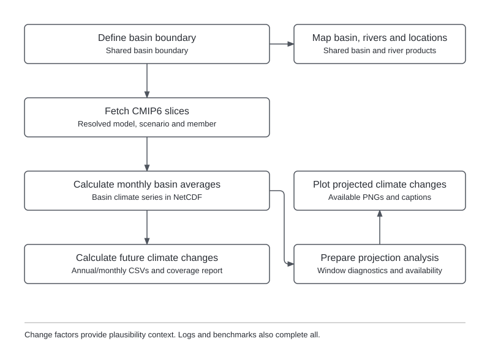

Projection analysis places the chosen stress-test range in the context of projected climate changes.
It compares basin-average temperature and precipitation between historical and future periods across
selected models and emissions scenarios. The results provide context for interpretation without
determining the weather scenarios used in the stress test.

## Inputs {#inputs}

- **Basin definition.** Geographical extent used to calculate basin-average climate changes.
- **Climate projections.** Historical and future climate data for selected models, scenarios and members;
  see the [dataset reference](climate-projection-data.md) for current support.
- **Projection catalog.** Data-access information for the selected ensemble, currently provided through
  the [CMIP6 catalog](catalog-climate-projections.md).

A hydrological model and historical-forcing extraction are not required.

Missing period coverage is reported for each combination, and usable combinations can continue.
If none are usable, change-factor tables contain headers only; corrupt data and incompatible
calendars remain errors.

Climate-projection analysis excludes CMIP6 `THU/CIESM` completely, across all variables, experiments and members, because its
published precipitation has an invalid scale. Excluding the whole model keeps the ensemble consistent
across variables; it does not establish a defect in temperature. Requested CIESM combinations remain in
coverage and composition records as `source_quality_excluded`, with the reason and counts, but create no
acquisition jobs and contribute to no analysis or change-factor products. Member overrides cannot restore
the model. Existing source caches are preserved; rerunning projection analysis rebuilds affected derived products using
the reduced ensemble. No speculative rescaling is applied. See
[Monerie (2026), section 4](https://doi.org/10.1088/2515-7620/ae661c) for independent evidence of the
precipitation problem. A request containing only excluded models fails with no resolved combinations.

## Configuration {#configuration}

**Project settings** define the basin through `basin.region` and `basin.resolution`.

**Workflow settings** define the projection ensemble and comparison periods. The annotated template is
`config/templates/example-basin/project_config_analyze_projections.yml`.

| Setting | Purpose |
|---|---|
| `catalog`, `ensemble` | Projection catalog and ensemble name, currently `cmip6`. |
| `models`, `scenarios` | Climate models and emissions scenarios. |
| `members.preference` | Preferred ensemble members. |
| `members.selection`, `members.overrides` | Optional member-selection refinements. |
| `reference_window` | Historical reference period in inclusive calendar years. |
| `future_windows` | Named future periods in inclusive calendar years. |
| `variables` | Variables and their change conventions. |
| `stats` | Summary statistics. |

Each projection is compared with its own modeled historical reference, independently of the observed
record used for model building. Temperature changes are additive in °C; precipitation changes are
relative. See [execution and run management](configuration-and-execution.md) for running the workflow.

## Processing sequence {#rule-flow}

{width=100% fig-alt="Scientific processing from basin and climate inputs to the assessment products described in this section."}

The workflow acquires available climate projections, calculates monthly basin averages and compares
historical and future periods. It then prepares diagnostic tables and figures; historical series can
serve several future scenarios. Data availability determines which comparisons can be produced.

## Outputs {#outputs}

Results are saved under `data/climate/projections/<ensemble>/`, relative to `project_dir`.
The main outputs are:

- **Climate data (`raw/` and `scalar/`).** Downloaded NetCDF grids and monthly basin-average series.
- **Change factors (`summary/`).** Annual and monthly changes in
  `<ensemble>_change_factors_annual.csv` and `<ensemble>_change_factors_monthly.csv`.
- **Coverage report (`report.md` and `summary/composition.csv`).** Available, partial and unavailable
  model–scenario–member comparisons; `summary/provenance.json` records their sources.
- **Diagnostic tables (`analysis/`).** Coverage, changes, seasonal cycles, model agreement and
  variability, with effective periods and availability in `_engine/analysis_record.json`.
- **Figures (`plots/full_period/` and `plots/period_<start>_<end>/`).** Available figures for the full
  record and analysis windows. `plots/figure_captions.md` and `_engine/figure_captions.json` explain
  produced and unavailable figures; title inventories accompany them.

Figures use the diagnostic tables, whose effective periods may differ from the change-factor tables.
Project `plotting.annotation` selects a title, caption or neither. See
[execution records](execution-and-provenance.md#wf2-product-attribution) for production records and
[results transfer](results-transfer.md) for export and import.

## Diagnostics and interpretation {#interpretation}

```{=html}
<span id="diagnostic-calculations-and-plot-reading"></span>
```

- **Reference and aggregation.** Temperature change is the future mean minus the reference mean;
  precipitation change is 100 × (future mean / reference mean − 1). Monthly averages account for
  month length in the model calendar; seasonal change diagnostics use precipitation rates, while
  seasonal totals are shown in mm.
- **Coverage.** Analysis retains complete water years within the calendar bounds, labeled by their
  starting year. Seasonal diagnostics require at least 90% of the window's water years, rounded up,
  and at least three complete seasons; each season requires three finite months.
- **Ensemble spread.** Change summaries average members within each model and then weight models
  equally; paired temperature–precipitation plots use one point per model and scenario. Median,
  interquartile and full-range summaries describe differences among models, while annual absolute-value
  plots show member medians and ranges. These ranges are not probabilities of future basin outcomes.
- **Interannual variability.** Standard deviation is calculated after removing a linear trend;
  precipitation CV divides detrended standard deviation by the original mean total. A future/reference
  ratio of one means unchanged variability, and annual member ratios are combined geometrically
  within models. Invalid ratios are excluded and recorded, rather than treated as no change.
- **Historical variability bands.** Grey bands show a 90% range of differences between window means
  expected from historical variability, assuming independent years. Positive serial correlation
  would widen the bands; they do not measure uncertainty in the projected change.
- **Sign agreement.** Agreement reports the fraction of models sharing the sign of the multi-model
  median after averaging members within models. It describes consistency of direction, not magnitude,
  significance or independent evidence, because related models are counted separately.
- **Dry periods and sparse ensembles.** Percentage changes exclude reference precipitation below
  the dry threshold (default 0.1 mm/day); CV also excludes dry future means. Hatching flags periods
  where at least half the models are excluded by this criterion, and affected summary plots omit
  scenario groups with fewer than ten models. Captions report eligible counts and omissions.

See the [processing rule reference](workflow-rule-reference.md#analyze-projections) for individual steps.
