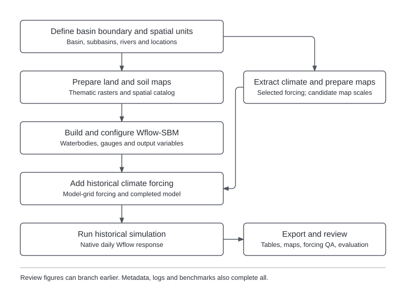

Model building prepares a Wflow-SBM basin model and runs it with historical weather. Maps, simulated
time series and comparisons with available discharge observations help assess its behavior before
stress testing. Construction uses global datasets and includes no local calibration.

## Inputs {#inputs}

- **Spatial data.** Terrain, hydrography, land cover, vegetation, soils and waterbody datasets for
  constructing the basin model.
- **Historical climate data.** Selected meteorological forcing for the historical simulation.
- **Build configuration files.** HydroMT settings, defaulting to `config/defaults/wflow_build_model.yml`
  and `config/defaults/wflow_update_waterbodies.yml`.
- **Reporting locations.** Optional CSV specifying locations for model outputs.
- **Discharge observations.** Optional CSV files for evaluation, with columns and units matching
  the modeled locations and variables.

See [input formats](data-formats-and-conventions.md) for file conventions and
[model preparation](model-preparation.md) for the role of each file and links to the upstream manuals.

## Configuration {#configuration}

**Project settings** define the basin, historical forcing and simulated variables.

| Setting | Purpose |
|---|---|
| `basin.region`, `basin.resolution` | Basin extent and model resolution. |
| `basin.output_locations` | Reporting locations. |
| `climate.forcings`, `climate.default_forcing`, `climate.window` | Forcing source and available record. |
| `model.outvars` | Variables saved for evaluation and later indicator calculations. |

**Workflow settings** control the historical simulation and evaluation. The annotated template is
`config/templates/example-basin/project_config_build_model.yml`.

| Setting | Purpose |
|---|---|
| `run_period.start`, `run_period.end` | Simulation years within the climate record. |
| `plotting.input_maps` | Spatial input maps; default `true`. |
| `plotting.forcing_figures` | Model-grid forcing maps and time series; default `false`. |
| `plotting.scales` | `[basin]` (default) or `[basin, locations]` for reporting-location and upstream-subbasin figures. |
| `plotting.view` | With several forcing sets: `comparison` (default) draws station discharge across runs only; `individual`/`both` keep the per-run station figures. |
| `hydromt.build_config_path` | Alternative HydroMT build configuration file. |
| `hydromt.waterbodies_config_path` | Alternative waterbody-update configuration file. |
| `output.netcdf_grid` | Optional native grids from this historical simulation. |
| `historical_forcings` | Named forcing sets to simulate on the fixed model; see [named forcing sets](forcing-comparison.md#named-recipes). |

Wflow treats the starting date as the initial state time. With daily forcing, the first output is one
day later; forcing must cover that first update through the requested end date. See
[execution and run management](configuration-and-execution.md) for running the workflow.

## Processing sequence {#rule-flow}

{width=100% fig-alt="Two-column flow diagram. Main column, top to bottom: define basin boundary and spatial units; prepare land and soil maps; build and configure Wflow-SBM (waterbodies, gauges and output variables); add historical climate forcing (model-grid forcing and completed model); run historical simulation (native daily Wflow response). Side boxes: extract climate and prepare maps (selected forcing and candidate map scales); export and review (tables, maps, forcing checks and evaluation). A note says review figures can branch earlier."}

The workflow prepares basin and thematic data, builds the model and adds historical forcing on the
model grid. It then runs the historical simulation, exports response tables and produces evaluation
figures. Basin and forcing maps can be produced before the simulation finishes; additional climate
sources may be extracted for shared map scales without changing the selected forcing.

## Outputs {#outputs}

Paths below are relative to the output directory. The completed model supplies subsequent hydrological
simulations; logs, benchmarks and configuration archives are described in [run records](run-records.md).

### Main outputs

- **Spatial data (`data/spatial/`).** Basin vectors, reporting-location registry, thematic maps and
  the spatial catalog.
- **Historical climate (`data/climate/historical/`).** The selected climate dataset and shared map
  reference, with additional map candidates where needed.
- **Basin model (`models/hydrology/wflow/`; the folder is `model.name`, see
  [one model per folder](#model-versions)).** Model maps in `staticmaps.nc`, settings in
  `wflow_sbm.toml`, geometries and the HydroMT build configuration files used to build the model.
  `_engine/outlet_index.csv` links outlets to reporting locations.
- **Historical forcing (`models/hydrology/wflow/forcing/`).** Model-grid forcing in
  `inmaps_historical.nc` and optional forcing-check figures (`plotting.forcing_figures: true`).
- **Simulated time series (`models/hydrology/wflow/historical/default/run/`).** Per-variable
  `output_<code>.csv` tables and `_engine/response_tables.json`, with registry IDs linking series to reporting
  locations. Native Wflow `output.csv` is removed after successful conversion. Evaluation reads the saved
  tables.
- **Evaluation (`models/hydrology/wflow/historical/default/plots/` and `tables/`).** Model-response
  figures and scores where observations are available, including `tables/performance_indicators.csv`
  and discharge summaries under `plots/locations/` when `plotting.scales` includes `locations`
  (with several forcing sets and `view: comparison`, these are drawn across runs in `forcing_comparison/`).

### Native grids

Optional `output.netcdf_grid` in this workflow's settings enables native grids at
`models/hydrology/wflow/historical/default/run/output_grid.nc`. See the shared
[configuration reference](configuration.md#netcdf-grid). This request is independent of
ensemble simulation output and leaves scalar outputs unchanged.

### Figure selection

Spatial plots and unique basin-average response figures are generated by default. Model-forcing
plots and individual location/subbasin figures are optional. Enable them in the model-building YAML:

```yaml
plotting:
  input_maps: true
  forcing_figures: true
  scales: [basin, locations]
```

- These switches affect figures only. Historical simulation, saved responses, per-variable time-series
  exports and observation-based performance metrics remain enabled.
- `input_maps` defaults to `true`; `forcing_figures` to `false` and `scales` to `[basin]`. `locations`
  controls both reporting-location and associated upstream-subbasin figures; basin-scale figures always
  render.
- The forcing comparison (`forcing_comparison/`) always renders with two or more forcing sets.
- Turning a family off leaves its previously generated files intact; the workflow no longer requests them.
  Turning it on requests any missing products through the usual run command.

Shared `plotting.annotation` remains in the project YAML. Unknown plotting keys and nonboolean switches
are errors.

## Diagnostics and interpretation {#interpretation}

- **Basin and forcing maps.** Maps show the model's spatial inputs and historical forcing.
  They support inspection of the basin setup before interpreting simulated responses.
- **Historical response.** Time series describe model behavior under the selected historical weather.
  Per-variable exports complement the native Wflow output and do not replace it.
- **Observation comparisons.** Available observations support evaluation of simulated behavior at
  matching locations. Without observations, response figures describe the simulation but do not
  establish model skill; see [limitations](limitations.md).

See the [processing rule reference](workflow-rule-reference.md#build-model) for individual steps.

## Observed catchment water balance

[]{#discharge-declaration}[]{#catchment-areas-and-forcing}[]{#ratios}[]{#saved-files}[]{#interpretation-1}

Optional `evaluation.budyko: true` in the model-building YAML screens observed runoff against selected
prepared historical precipitation and PET. See [observed catchment water balance](catchment-water-balance.md).

## One model per folder {#model-versions}

Each folder under `models/hydrology/` is one self-contained model: its static maps, TOMLs, every forcing set's
run and their comparison. `model.name` in the project file names the model folder that model building creates
or runs and hydrological simulation uses; the default is `wflow`.

### Changing model settings

A model's runs change only when it is rerun with the same model settings. To try different model-building
settings (another soil dataset), set a new `model.name`: model building refuses to rebuild an existing model
whose model-building settings changed and names the setting that differs.

### Model record

Every model records itself in `_engine/model.json`: its origin, parent, notes and a record of its
static inputs (the `wflow_sbm.toml` pointer graph plus `staticgeoms/`, excluding everything the toolbox
writes per forcing set). The `write_model_record` rule writes this record for a model the toolbox builds
(`origin: built`) after every build.

### Registered models

A model prepared outside the toolbox is registered with `scripts/register_model.py register`
(`origin: user_managed`); see [Use a calibrated model](../guide/calibrated-model.md).

- Model building never rebuilds or rewrites a registered model: the model-building rules (`build_wflow_model`
  to `declare_gauges_and_outputs`) are not defined for it, and `publish_registered_model` checks it again and
  marks it final as registered.
- Every forcing set, including a single one, uses the staged forcing update and writes its own TOML, so a
  single forcing set writes `wflow_sbm_default.toml` beside the model's own `wflow_sbm.toml`.
- Before planning, model building refuses a registered model whose files changed since registration and one
  whose TOML lacks an output that `model.outvars` or `build_model.output` asks for, naming each.

### Use in simulation

Hydrological simulation uses `model.name`; with several models and no name it stops and lists them. It refuses
a registered model that changed since registration, and a saved experiment refuses a different model
(`--new-experiment`). Each experiment's `_engine/model_reference.yml` records the model folder and a hash
of its forcing-set inputs.

### Comparisons and model record {#comparisons-and-model-identity}

Comparisons across models (`scripts/register_model.py compare`) are written to
`models/hydrology/comparisons/<name>/` with the same tables and figures as a model's own
`historical/forcing_comparison/`. The runs must cover the same simulation period and initialization; the
evaluation window is every complete reporting year they share.

The model record kept with each comparison covers scientific TOML settings and referenced static,
cyclic, waterbody and initial-state inputs, including forcing variable bindings, scales and offsets. It
excludes the forcing file contents and pointer, simulation dates, output configuration and logging paths,
which have separate source and compatibility checks. NetCDF inputs use content hashes independent of
compression and container timestamps.

## Named forcing sets {#named-recipes}

[]{#compare-recipes}[]{#compare-retained-historical-runs}[]{#requirements}[]{#evaluation-period}
[]{#dates-and-scores}[]{#output-tables}[]{#regenerate-figures}[]{#limits}

With several forcing sets, the workflow builds the model once, simulates each set separately and compares
them automatically. See [forcing-set comparison](forcing-comparison.md).
