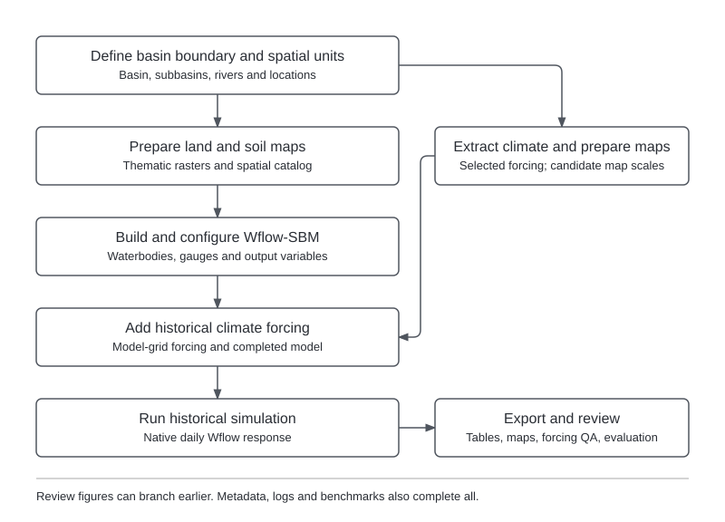

Model building prepares a Wflow-SBM basin model and runs it with historical weather. Maps, simulated
time series and comparisons with available discharge observations help assess its behavior before
stress testing. Construction uses global datasets and includes no local calibration.

## Inputs {#inputs}

- **Spatial data.** Terrain, hydrography, land cover, vegetation, soils and waterbody datasets for
  constructing the basin model.
- **Historical climate data.** Selected meteorological forcing for the historical simulation.
- **Model-building recipes.** HydroMT settings, defaulting to `config/defaults/wflow_build_model.yml`
  and `config/defaults/wflow_update_waterbodies.yml`.
- **Reporting locations.** Optional CSV specifying locations for model outputs.
- **Discharge observations.** Optional CSV files for evaluation, with columns and units matching
  the modeled locations and variables.

See [input formats](data-formats-and-conventions.md) for file conventions and
[model preparation](model-preparation.md) for recipe roles and links to the upstream manuals.

## Configuration {#configuration}

**Project settings** define the basin, historical forcing and simulated variables.

| Setting | Purpose |
|---|---|
| `basin.region`, `basin.resolution` | Basin extent and model resolution. |
| `basin.output_locations` | Reporting locations. |
| `climate.forcing.precip_source`, `climate.window` | Forcing source and available record. |
| `model.outvars` | Variables saved for evaluation and later indicator calculations. |

**Workflow settings** control the historical simulation and evaluation. The annotated template is
`config/templates/example-basin/project_config_build_model.yml`.

| Setting | Purpose |
|---|---|
| `simulation_window.start`, `simulation_window.end` | Simulation years within the climate record. |
| `observations` | Observed CSV files associated with modeled variables. |
| `evaluation.subbasin_plots` | Additional evaluation figures for individual subbasins. |
| `engine.build_config` | Alternative HydroMT model-building recipe. |
| `engine.waterbodies_config` | Alternative waterbody-update recipe. |
| `output.netcdf_grid` | Optional native grids from this historical simulation. |
| `historical_forcings` | Named recipes to simulate on the fixed model; see [named recipes](#named-recipes). |

Wflow treats the starting date as the initial state time. With daily forcing, the first output is one
day later; forcing must cover that first update through the requested end date. See
[execution and run management](configuration-and-execution.md) for running the workflow.

## Processing sequence {#rule-flow}

{width=100% fig-alt="Scientific processing from basin and climate inputs to the assessment products described in this section."}

The workflow prepares basin and thematic data, builds the model and adds historical forcing on the
model grid. It then runs the historical simulation, exports response tables and produces evaluation
figures. Basin and forcing maps can be produced before the simulation finishes; additional climate
sources may be extracted for shared map scales without changing the selected forcing.

## Outputs {#outputs}

Optional `output.netcdf_grid` in this workflow's settings enables native grids at
`models/hydrology/wflow/run_default/output_grid.nc`. See the shared
[configuration reference](configuration.md#netcdf-grid). This request is independent of
ensemble simulation output and leaves scalar outputs unchanged.

Paths below are relative to `project_dir`. The main outputs are:

- **Spatial data (`data/spatial/`).** Basin vectors, reporting-location registry, thematic maps and
  the spatial catalog.
- **Historical climate (`data/climate/historical/`).** The selected climate dataset and shared map
  reference, with additional map candidates where needed.
- **Basin model (`models/hydrology/wflow/`).** Model maps in `staticmaps.nc`, settings in
  `wflow_sbm.toml`, geometries and the HydroMT recipes used to build the model.
  `staticgeoms/outlet_index.csv` links outlets to reporting locations.
- **Historical forcing (`models/hydrology/wflow/forcing/`).** Model-grid forcing in
  `inmaps_historical.nc` and forcing-check figures.
- **Simulated time series (`models/hydrology/wflow/run_default/`).** Native Wflow `output.csv` and
  per-variable `output_<code>.csv` tables, with a gauge crosswalk linking model IDs to station names.
- **Evaluation (`models/hydrology/wflow/evaluation/`).** Model-response figures and scores where
  observations are available, including `performance_indicators.csv` and station discharge
  summaries under `plots/stations/`.

The completed model supplies subsequent hydrological simulations. Logs, benchmarks and configuration
archives are described in [execution records](execution-and-provenance.md).

## Diagnostics and interpretation {#interpretation}

- **Basin and forcing maps.** Maps show the model's spatial inputs and historical forcing.
  They support inspection of the basin setup before interpreting simulated responses.
- **Historical response.** Time series describe model behavior under the selected historical weather.
  Per-variable exports complement the native Wflow output and do not replace it.
- **Observation comparisons.** Available observations support evaluation of simulated behavior at
  matching locations. Without observations, response figures describe the simulation but do not
  establish model skill; a successful run alone does not establish predictive adequacy.

See the [processing rule reference](workflow-rule-reference.md#build-model) for individual steps.

## Observed catchment water balance

Optional `evaluation.budyko` in the model-building YAML screens observed runoff against selected
prepared historical precipitation and PET. It requires the existing `observations.river discharge` CSV
and this explicit support declaration:

```yaml
evaluation:
  budyko:
    discharge_statistic: daily_mean
    time_label: interval_end
```

Both fields are required; `time_label` also accepts `interval_start`. Omitted, null or false disables
the diagnostic. Bare true and incomplete or unknown settings fail with a complete configuration example.
The declaration asserts daily mean m³/s over midnight-to-midnight UTC days. Naive timestamps are asserted
UTC; aware timestamps normalize to UTC and must land at midnight. Start labels shift one day in a derived
series; the input CSV and ordinary model evaluation retain their labels. The toolbox checks structure
and records the declaration as user-supplied support; it cannot establish measurement provenance from values.

The diagnostic uses original snapped upstream catchments and hydrography cell areas. Prepared model
forcing is sampled at those cell centres using nearest cells, then area-weighted. The same contributing
area converts daily mean Q to depth with `Q * 86400 * 1000 / area_m2`. This discretization is a screening
approximation; inspect station areas and forcing coverage before interpreting departures.

Only complete matched water years of precipitation, PET and observed Q enter the ratios. The covered day
(interval end minus one day) determines window and water-year membership. Missing days remain missing;
partial edge years are excluded, and no spin-up year is removed. Aridity is total PET / total P and runoff
coefficient is total runoff depth / total P over the same retained years. Zero P or no eligible years
produces an unavailable result. These are ratios of totals, rather than averages of annual ratios.

Outputs live in `models/hydrology/wflow/evaluation/budyko/`: `tables/stations.csv`, `annual.csv` and
`summary.csv`, the diagram in `plots/`, and daily evidence, input hashes and support declarations in
`_engine/`. The target `evaluate_budyko` requires model/forcing preparation but no Wflow simulation.
Retained tables support `scripts/render_figures.py budyko --project <project_dir> --out <new_dir>`.

Water and energy limits describe long-term equilibrium assumptions. Short/discontinuous records,
storage changes, regulation, transfers, basin area and forcing/observation errors can explain departures.
The residual `1-Q/P` is not measured ET. Unusual points remain visible; no automatic pass/fail or source
ranking is supplied. Tables retain counts, actual years and exclusion reasons for inspection.

## Retain historical simulations

By default, historical simulation writes the current `run_default` results. To keep a named response
for later forcing comparisons, add this optional setting to the model workflow configuration:

```yaml
# project_config_build_model.yml
historical_run:
  # Unique lowercase label; changing the forcing does not change this label automatically.
  name: era5_reference
```

Run the model workflow through the usual runner. Retention requires a fresh historical simulation;
it does not attach today's configuration to an older `output.csv`. Choose a new name for each run.
Names use lowercase letters, digits and underscores, start with a letter, and contain at most 64 characters.
An unchanged completed run permits normal up-to-date workflow requests. A scheduled execution under an
existing name is refused before Wflow runs; changed inputs require a new name. Inputs are the model, TOML,
forcing file and record, station registry and simulation code. Other configuration edits, such as adding a
recipe or enabling later workflows, do not reschedule a retained run; its archive keeps the configuration
it executed with. Unrelated figure targets
remain usable. When the simulation enters the DAG, retained payloads and its completion receipt are validated.
Omitting `historical_run` or setting it to null preserves the existing behavior.

Completed runs live under `simulations/historical/<name>/` in the project. Each contains the unrounded
native `output.csv`, full-precision discharge keyed by registry ID in `discharge.csv`, the executed TOML,
station registry and crosswalk, effective forcing recipe, composed configuration, input fingerprints,
and completion evidence. Publication is atomic; incomplete staging directories are not readable runs.
Source changes during execution prevent publication. Retained readers verify every payload hash.
The declared workflow output `simulations/historical/_engine/<name>.json` binds the archive completion hash.
Every new label therefore schedules retention even when `run_default` already exists. Receipts live outside
immutable archives so workflow cleanup cannot delete archival evidence. Missing/damaged archives or receipts
are not accepted as completed workflow state. Archives created before receipts were introduced remain
readable for comparison; requesting their labels as simulation outputs requires a new label, not overwriting
or reconstructing the original run.
Use the normal workflow or target the completion receipt for an up-to-date check. Explicitly targeting
`run_historical_simulation` also requests fresh invocation logs/benchmarks and can schedule execution;
the existing-name collision guard still applies.
Failed stages remain as hidden `.partial` directories for inspection. A killed process can also leave
a hidden `.lock` reservation; inspect it and confirm no writer is active before removing that reservation.
Choose a new run name when uncertain. Readers never treat either location as a completed run.

The fixed-model identity covers scientific TOML settings and referenced static, cyclic, waterbody and
initial-state inputs, including forcing variable bindings, scales and offsets. It excludes the forcing file
contents and pointer, simulation dates, output configuration and logging paths; those have separate provenance
and compatibility checks. Older retained identities recover forcing mappings from their verified TOML snapshot
in memory, preserving archived bytes. NetCDF inputs use content
hashes independent of compression and container timestamps. Station identities are checked separately.

Retention supports comparison after the current model or `run_default` changes. It is **not a complete
model archive for re-execution**: the fingerprints identify model and forcing inputs but do not copy them.
Keep those inputs and the recorded software environment separately if model re-execution is required.

## Named historical recipes {#named-recipes}

With [named recipes](configuration.md#named-historical-forcing-recipes), WF1 builds the model once and simulates
each recipe in `build_model.historical_forcings` separately. Each recipe owns
`forcing/<id>/inmaps_historical.nc`, `wflow_sbm_<id>.toml`, `run_<id>/`, `config/<id>/` and
`evaluation/<id>/`. The shared `wflow_sbm.toml`, `staticmaps.nc` and geometries are never rewritten per
recipe, and rerunning one recipe leaves the others' files untouched. Two or more recipes require
`historical_run.name`; each is retained as `<name>_<id>` and the runs are compared automatically.
A single-recipe project keeps `forcing/inmaps_historical.nc`, `wflow_sbm.toml` and `run_default/`.

## Compare retained historical runs

When `build_model.historical_forcings` runs two or more named recipes, WF1 compares their retained runs
itself (rule 1.13b) into `comparisons/historical/<historical_run.name>/`. It evaluates every complete
reporting year the runs share: responses are labelled at interval end, so the first simulated year is
never complete. The generated settings are kept as `comparisons/historical/_engine/<name>.yml`, a valid
input for the script below.

Use `scripts/compare_historical.py --config comparison.yml` after retaining the runs. This command
reads retained responses and never launches Wflow. Paths resolve beside the comparison YAML.
The output directory must not exist; choose a new directory for a changed comparison.

```yaml
project_dir: ./my-basin
runs:
  - era5_reference
  - chirps_reference
evaluation_window:
  # First reporting year, labelled by its start year. Input: integer year.
  start: 2002
  # Last reporting year, inclusive. Input: integer year >= start.
  end: 2004
# Start-year labels: October 2002 through September 2003 is water year 2002.
# The complete evaluation window here is 2002-10-01 through 2005-09-30.
water_year_start: Oct
# Optional semicolon CSV: time;1010;1020 (stable registry wflow_id columns).
# Values are daily discharge in m3/s, labelled at interval end, like native WF1 output.
observations_path: ./observations.csv
output_dir: ./my-basin/comparisons/historical/forcing_comparison
```

The requested dates must all exist in every run. The comparison requires identical fixed-model identity,
simulation dates, timestep, initialization and station identity; only daily Gregorian responses are supported.
Recipe names select runs, not new forcing settings. The inventory retains each executed recipe and provenance.
The window expands inclusive integer reporting-year labels using `water_year_start`; no water-year trimming
or endpoint shortening occurs. Water-year labels use their starting year and seasonal months start at
`water_year_start`. Exact requested and warm-up boundaries are retained in `comparison.json`.

Warm-up preserves WF1's current behavior: when a run has more than 365 samples, exclude timestamps before
its first response timestamp plus one calendar year. This can exclude 366 samples across a leap year.
Runs with at most 365 samples have no warm-up exclusion. Each run supplies its own simulated warm-up;
the common exclusion uses the identical response calendar. Requested warm-up dates remain in the coverage
tables but never enter diagnostics. A wholly excluded window is reported with unavailable results.

At each station, simulation-only diagnostics use dates with finite nonnegative discharge in **all** runs.
Observation-paired diagnostics additionally require finite nonnegative observations on those same dates.
Missing stations or dates are reported without infilling. Duplicate or unknown observation station IDs,
duplicate dates and non-midnight timestamps are errors. Missing observation columns are allowed.
Daily and monthly KGE, NSE, NSElog, RMSE, MSE, Pbias and VE reuse WF1's existing calculations. Monthly
means use the same available paired days, with no completeness threshold. Undefined scores retain reasons;
simulation-only results make no skill claim. Seasonal curves average available monthly means equally
within calendar month; flow-duration curves rank available daily values using rank/(count+1), retaining zeros.

Outputs include `inventory.csv`, `coverage.csv`, `performance.csv`, `support.csv`, `daily.csv`, `monthly.csv`,
`seasonal.csv` and `flow_duration.csv` under `tables/`. `support.csv` records every requested date and the
warm-up, simulated-common and observation-paired masks. Coverage counts and first/last usable dates are
station-specific; unavailable observations are explicit. Figures cover every station on each applicable
support, using the shared CST preset, palette, legends and caption/title inventories. Numerical tables and
their hashes are retained for independent inspection and rerendering, without current model files:

```powershell
pixi run python scripts/render_figures.py historical-hydrology --project <comparison-dir> --out <figure-dir>
```

Controlled checks establish arithmetic and artifact handling, not real-basin forcing suitability, local
calibration or empirical model adequacy. Review coverage before interpreting comparative performance.
