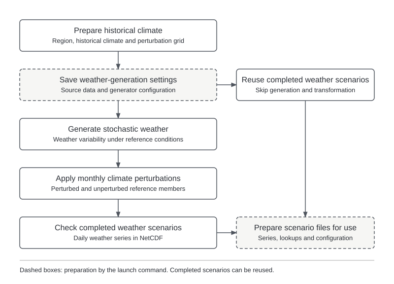

Scenario generation produces daily weather for testing basin sensitivity to temperature and
precipitation changes. It generates stochastic realizations from the selected historical record and
applies analyst-defined monthly perturbations. Generation is independent of climate projections and
the hydrological model, allowing the resulting weather scenarios to be reused.

## Inputs {#inputs}

- **Historical climate data.** Selected NetCDF record used to train the weather generator.
- **Basin cells.** CSV identifying the climate-grid cells included in the basin.
- **Climate perturbations.** Monthly temperature and precipitation settings defining the tested conditions.
- **Weather-generator recipe.** Generation settings, defaulting to `config/defaults/weathergen_config.yml`.

Saved inputs and settings allow later checks that reused scenarios represent the same weather experiment.

## Configuration {#configuration}

**Project settings** define the basin, historical source and training record through `basin`,
`climate.forcing.precip_source` and `climate.window`.

**Workflow settings** define the generated period and perturbation grid. The annotated template is
`config/templates/example-basin/project_config_generate_scenarios.yml`.

For schema-3 projects, set `method: stochastic` and place the settings below under `stochastic:`.
The alternative `method: delta_change` takes an inline `delta_change:` section
([`delta-change/3`](delta-change-scenarios.md), driven by WF2's gridded changes). Supply exactly the
selected section; mixed methods,
unknown methods and mixed flat/nested fields are refused. Legacy flat stochastic files remain supported
under project schemas 2 and 3. Nested stochastic settings normalize to the same effective producer inputs.
Relative paths remain anchored beside their declaring workflow YAML. Existing stochastic collection
selection and reservation behavior are preserved.

| Setting | Purpose |
|---|---|
| `simulation_window` | Years covered by the generated scenarios. |
| `n_realizations` | Number of stochastic realizations per climate condition. |
| `seed` | Fixed integer or `auto` for a reproducibly derived choice. |
| `climate_perturbations.temp.mean.min/max` | Monthly temperature-change bounds in °C. |
| `climate_perturbations.precip.mean.min/max` | Monthly precipitation multipliers; 1 is unchanged. |
| `n_levels` within each axis | Number of sampled levels along that axis. |
| `trajectory` within each axis | `constant` or `transient` application of the change. |
| Precipitation `variance.min/max` | Variability bounds when `scale_var_with_mean` is false. |
| `spell_factors.dry/wet` | Changes in spell length, without adding grid axes. |

[]{#field-constraints-and-refusals}

Monthly bounds contain twelve values, January–December; precipitation multipliers must be positive.
Realization and level counts must be positive integers, and the scenario start year cannot precede the
historical record's end year. The [weather-generation chapter](weather-generation.md) explains the
perturbation methods and generator settings.

## Processing sequence {#rule-flow}

{width=100% fig-alt="Scientific processing from basin and climate inputs to the assessment products described in this section."}

The workflow prepares historical data and the perturbation grid, then saves the generation inputs
and settings. It generates unperturbed weather and transforms every delivered series, including the
unperturbed references. Compatible completed scenarios can be reused without generating new weather.

The launch command performs input snapshots and experiment preparation before the generation rules.
Running through `scripts/run_workflows.py` completes both phases, as described in the
[running guide](../guide/running.md); a dry run does not create completed scenarios.

## Outputs {#outputs}

Paths below are relative to `project_dir`. Each scenario set has one folder, `scenarios/<name>/`.
The name defaults to `stochastic-<start>-<end>`; set `name` in the generation settings to choose another.
A set with new content under a used name gets `-2`, `-3`; an unchanged rerun reuses its set whatever the
configured name, which is then listed as an alias. Names never affect a set's identity.

- **Daily weather (`series/<run_id>.nc`).** One NetCDF series per unperturbed or perturbed run.
- **Scenario lookup (`scenario_run_lookup.csv`).** Links run identifiers to realizations and
  points on the perturbation grid.
- **Perturbation lookup (`perturbation_lookup.csv`).** Twelve monthly temperature and
  precipitation changes for each grid point.
- **Generation settings (`config/` and `weathergenr/`).** Configuration, weather-generator settings and
  generation products.
- **Set record (`_engine/collection.json`).** Completion, identity and the checked file inventory used by
  hydrological simulation.
- **Index (`scenarios/collections.csv`).** Every set in the project: `name, aliases, method, id,
  description, created, status`. It is rebuilt from the set records after each generation.

Sets from earlier versions stay where they are (`scenarios/_engine/data/<id>/`) and are listed in the index as
`retained-<id>`. See [saved results](retained-handoffs.md#scenario-exports-and-lookups) for lookup columns and
reuse requirements.

## Diagnostics and interpretation {#interpretation}

- **Unperturbed reference.** Each realization includes generated weather without imposed climate
  changes. It samples variability under the generator's reference settings rather than replaying
  the historical record.
- **Perturbation grid.** Temperature and precipitation levels combine to form the tested conditions.
  Temperature changes are in °C; precipitation changes in the lookup are percentages, although the
  configuration uses multipliers.
- **Trajectories.** A constant trajectory applies the full change from the start; a transient trajectory
  ramps from unchanged conditions to twice the selected change, subject to the generator's factor floor.
  These choices define different climate experiments and affect interpretation of the response.
- **Variability and spells.** The default recipe derives precipitation variance from the mean factor;
  separate variance bounds apply only when `scale_var_with_mean` is false. Dry- and wet-spell factors
  adjust spell lengths without expanding the temperature–precipitation grid.
- **Reuse.** Saved inputs identify the weather experiment represented by each set of scenarios.
  Changed generation settings or incompatible source coverage cannot be silently substituted into it.

See the [processing rule reference](workflow-rule-reference.md#generate-scenarios) for individual steps.
