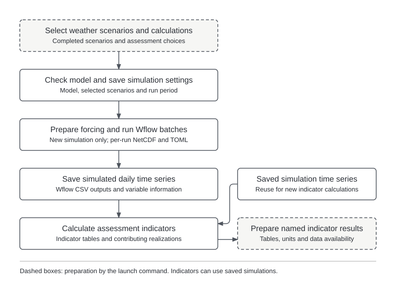

Hydrological simulation combines the prepared basin model with generated weather to assess responses
across climate conditions. It saves daily time series and calculates indicators at reporting locations.
Compatible indicator calculations can also use saved simulations without rerunning the model.

## Inputs {#inputs}

- **Prepared basin model.** Completed Wflow-SBM model and the information needed to prepare its forcing.
- **Historical end state.** WF1's `run_default/outstate/outstates.nc` (`run_<id>/` for a named recipe),
  the default initial state for every run unless the model TOML configures its own warm state.
- **Generated weather.** Climate NetCDFs for selected runs, including pressure and radiation alongside
  perturbed rainfall and temperature.
- **Saved responses for indicators-only calculations.** Rounded per-variable CSVs and records of available
  variables and locations, used when recalculating indicators without new simulations.

HydroMT-Wflow prepares model-grid forcing and recalculates potential evapotranspiration; pressure and
radiation receive no separate climate-change perturbation. See
[weather-to-forcing preparation](model-preparation.md#weather-to-forcing) for details.
Changing the model or weather experiment requires a new experiment; missing variables require new
simulations. Climate projections are not simulation inputs.

## Configuration {#configuration}

**Project settings** define saved variables through `model.outvars` and reporting locations through
`basin.output_locations`. The simulation period comes from the selected weather-generation experiment.

**Workflow settings** select simulations, indicators and computing resources. The annotated template is
`config/templates/example-basin/project_config_simulate_system.yml`.

| Setting | Purpose |
|---|---|
| `operations` | Simulations, indicators, or both. |
| `indicator_sets`, `indicator_selection` | Indicator calculations and optional narrower selection. |
| `indicator_evaluation` | `partial` (default) publishes gaps as unavailable with a warning; `strict` refuses. |
| `include_unperturbed` | Include reference simulations required by reference-based indicators. |
| `initialization` | Initial state (`auto`, `historical`, `cold`) and discarded `warmup_years` (default 1). |
| `experiment_name` | Name of the saved experiment. |
| `scenario_collection` | Advanced selection of a saved weather experiment. |
| `compute` | Julia threads, concurrent batches, batch size and reserved disk space. |
| `output.netcdf_grid` | Optional native grids for every selected run; independent of historical output. |
| `output.csv.decimal_places` | Retained daily scalar precision, default 5; see [precision](configuration.md#csv-precision). |
| `historical_forcing` | `default` (or omitted) or a named recipe; see below. |

**Historical forcing selection.** With [named recipes](configuration.md#named-historical-forcing-recipes),
`historical_forcing` chooses the recipe whose `wflow_sbm_<id>.toml`, model fingerprint, forcing
preparation, end state and historical Qcrit discharge the experiment uses. Single-recipe projects accept
only `default`. WF4 refuses a recipe WF1 has not simulated, a scenario collection whose forcing extraction
differs from the recipe, and any non-default recipe for delta-change collections, which record no recipe.
An existing experiment keeps the recipe it was created with: changing the selection requires
`--new-experiment`, and indicators-only recalculation refuses a different selection.

Scenario selection normally follows the project's scenario-generation settings. Omitting unperturbed
simulations does not remove the reference weather saved by scenario generation. See
[indicator requests](indicator-requests.md) for selection syntax and
[configuration](configuration.md#workflow-settings) for advanced settings.

## Processing sequence {#rule-flow}

{width=100% fig-alt="Scientific processing from basin and climate inputs to the assessment products described in this section."}

The workflow checks the model and selected scenarios, prepares forcing and runs Wflow. Each run starts
from the selected [initial state](hydrological-simulation.md#initial-conditions-and-warm-up) and first
simulates its discarded warm-up years. Indicators are then calculated from saved daily responses.
Simulations can run alone, or compatible saved responses can supply indicators-only calculations when
the required variables, locations and periods are available.

Execution uses `scripts/simulate_system.py` or `scripts/run_workflows.py`, as described in the
[running guide](../guide/running.md). Each completed indicator set is saved independently, so the final
command outcome and each set's availability determine whether all requested calculations succeeded.

## Outputs {#outputs}

Results are saved under `experiments/<experiment-name>/`, relative to `project_dir`.
The main outputs are:

- **Daily responses (`hydrology/wflow/output/<run_id>/output_<code>.csv`).** Rounded per-variable time
  series, with `_engine/response_tables.json` inside the run directory. Warm-up days are discarded before
  retention. Native scalar CSVs and forcing NetCDFs are temporary; indicators read the retained tables.
- **Model settings (`hydrology/wflow/run_settings/<run_id>.toml`).** Settings associated with each run.
- **Optional native grids (`hydrology/wflow/output/<run_id>.nc`).** One retained file per run,
  containing all requested variables and native layers over the full native clock, warm-up included.
  See [grid settings](configuration.md#netcdf-grid).
- **Simulation records (`_engine/simulation.json` and `_engine/response_inventory.json`).** The model
  and scenario experiment used, completed simulations and available response data.
- **Indicator results (`results/indicator_sets/<set-id>/`).** Run and group indicator tables,
  `group_members.csv`, `group_metadata.csv` and the `indicators.csv` dictionary of units and methods.
- **Calculation records (`_engine/indicator_sets/<id>/`).** Saved indicator definitions, tables,
  included simulations and evidence of how calculations were completed.

Indicator tables use `<token>_run_indicators.csv` and/or `<token>_group_indicators.csv`. Each value
identifies its indicator, location and run or group, with a status and reason where needed.
See [saved results](retained-handoffs.md) for detailed schemas and reuse requirements.

## Diagnostics and interpretation {#interpretation}

- **Climate responses.** Scenario lookups link simulated responses and indicators to climate
  perturbations and realizations. Reference-based indicators require the corresponding unperturbed
  simulations and suitable comparison periods.
- **Unavailable values.** Missing or undefined indicator values are not zero. Status and reason
  fields explain which calculations could not be completed.
- **Completed sets.** One indicator set can finish even when another fails, and named result folders
  may therefore contain results from different runs. The final command outcome and availability
  records establish which results are ready to compare.
- **Recalculation.** Compatible indicator requests can use saved responses without rerunning Wflow.
  Indicators-only execution adds results to the existing experiment without creating simulations or
  merged simulation logs and benchmarks.

[]{#local-calculation-sets}

The [indicator references](indicator-extension.md) describe the five calculation sets and custom
extensions. The full `flood_risk` example includes unsupported probabilities; eligible 2- or 10-year
declarations must be selected explicitly as shown in [indicator requests](indicator-requests.md).

[]{#integrity-and-numerical-rechecking}

[Inspection commands](indicator-requests.md#integrity-and-numerical-rechecking) describe integrity
checks and numerical rechecking. Integrity checks do not make stale results reusable, and numerical
rechecking has additional prerequisites.

See the [processing rule reference](workflow-rule-reference.md#simulate-system) for individual steps.
